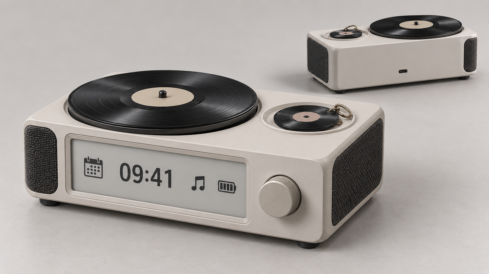

# Record Companion · 唱片桌搭

**一句话：** 一台离线的桌面音乐播放器，把带 NFC 的小唱片挂件放上去就能播放绑定的歌曲。

*概念效果图，仅用于外观审阅；旋钮、尺寸和布局均未冻结。*

**当前进度（2026-10-14）：** 各分支成果已进入统一基线，本轮继续完成软件主版本与L3/SolidWorks研究工程的实质整合。软件入口、研究模型和证据索引见下表；硬件仍在材料准备与模块验证阶段。

**第一次阅读：** 文档中的 A/B/C 模式和 D、F、T、X、RC 等编号见 [术语与编号速查](GLOSSARY.md)。

---

Record Companion 是一个可共同设计的音乐唱片桌搭：本体离线播放本地音乐，配合前置显示、灯光和可选的唱片转动；小唱片既是内容入口，也可以作为书包挂件。首批共八张以圆形为基础的卡：两张歌手卡、通用1–5和近圆形蛋糕生日0，基础功能不依赖互联网。

后续软件以[ABC控制器整合版](firmware/simulator/README.md)为主，普通选曲开机静音恢复、绑定页放片不播放、暂停NEXT仍暂停已实现并通过PC回归；首次失败、故障保护及补充工程的异步/恢复场景也已融入，见[V023](product/validation.md#v0232026-10-14-软件主版本实质整合)。建模以plan分支最新[L3空间研究](mechanical/studies/l3-v01/README.md)继续，更新真实读卡板外形及维护研究；SW原生装配在本机保存，公开可编辑研究源、STEP及脱敏证据。主控仍先ESP32-S3模块验证、成品ESP32-S31；准确成品模组、外围、外壳尺寸和材料依实物证据收敛，AI留后续。

## 先看这里

日常推进先读本页、[项目计划](product/plan.md)和当前功能专项；涉及整机范围、共享资源或验收时，再查相应产品文档。总规划协调八条功能专项与主控系统架构子规划，各专项可以并行调研和验证。

| 入口 | 内容 |
|---|---|
| [术语与编号速查](GLOSSARY.md) | A/B/C模式、D/F/P/T/X/RC等编号与平台术语的解释 |
| [当前任务清单](TASKS.md) | RC-08可实施待办、准入门槛、阶段验证和仓库缺失文件检查 |
| [播放与内容PC仿真](firmware/simulations/playback-controller/README.md) | 补充验证归档：SQLite、合成WAV发布、旧句柄及进程恢复；不作为第二主控制器 |
| [ABC控制器仿真](firmware/simulator/README.md) | 软件唯一开发入口，已融入D093–D095、故障/迟到回调和JSON恢复；实际回归见V023 |
| [L3空间研究](mechanical/studies/l3-v01/README.md) | plan分支时间最新的建模主线（D092）；可编辑模型、STEP与离线查看器，尺寸未冻结 |
| [项目计划](product/plan.md) | P0–P7阶段、当前进度、并行专项、候选比较和嘉立创试制流程 |
| [整机规划](product/README.md) | 已确认产品、F01–F17功能范围与跨功能目标 |
| [共享接口](product/interfaces.md) | 音频、屏幕、识别、网络、电源、空间和功耗约束 |
| [主控资源分配稿](features/platform/resource-allocation.md) | S3参考台架与S31成品模组的资源、候选GPIO及改配条件 |
| [决策记录](product/decisions.md) | 用户决定、编号与后续调整 |
| [整机验收](product/validation.md) | T01–T12计划和V001起的实际证据，包含软件整合、CAD研究与读卡器EDA检查 |
| [功能专项](features/) | 八条功能专项，以及主控与系统架构选型 |
| [参考来源](references/README.md) | 外部作品、器件、技能与许可记录 |

## 已确认的产品行为

- 本体是通用本地音乐播放器，无唱片也能通过本体或网页播放。
- 左右独立声道与前置屏是当前评估方向；音质优先于盲目压缩体量，最终尺寸由扬声器、音腔、电池和装配证据共同确定。
- 八张卡以圆形为基础，生日卡细化为近圆形蛋糕轮廓，对应可重设的内容绑定；生日仍只有一张卡和一个菜单入口。挂件采用无电池的NFC或类似电磁感应技术，具体器件待验证。
- 音质与性价比两条声音路线都做完整模块测试，按约1米听距比较，具体器件与预算待审阅。
- 大唱片确定平放；浅座与无需扣紧的插槽比较仅针对小挂件。
- 唱片是并列操作入口，分A单曲点播（取走继续）、B驻留模式（确认取走退出并停止清空）、C锁存模式（取走继续）。有效新A及本体/网页主动点歌先退出旧B/C；同片持续在位不重复触发，ABC行为由本体按电子身份解释。
- 本体离线覆盖基本全部首版功能；手机网页用于控制、上传、绑定和AP配网，外部网络断开时本地功能继续。
- 内置电池支持Type-C边充边用，续航目标为尽量长；容量、输入功率和时长尚待测量。

**RC-06内容管理规则（D076–D081）：** 保护被引用歌曲不直接删除；B/C运行中歌单编辑和在位重绑不打断当前会话；STOP后显式播放从停止时那首曲目0:00开始；运行中坏歌跳过、全不可播则停音频而模式继续；本体基础离线编辑，设备AP网页承担复杂批量管理。见[决策记录](product/decisions.md)和[接口规划](product/interfaces.md)。

**RC-07确定规则（D082–D085）：** B/C停止音乐后模式内NEXT只选曲、依然静音；引用中的歌单不能直接删除且删歌单不删歌曲；坏曲完整修复并发布后自动解除本会话失败标记、下次正常轮到再试；本体与网页以设备端最后成功保存的配置为准，网络重试防二次写入。详见[决策记录](product/decisions.md)。

## 功能专项

| 目录 | 关注范围 |
|---|---|
| [platform](features/platform/README.md) | 主控候选、计算/解码分工、原型开发板、内存与接口资源、软件支持及费用 |
| [audio](features/audio/README.md) | 本地文件、左右声道、存储、功放与试听 |
| [display](features/display/README.md) | 墨水屏候选、时间/日期、播放器状态、事件和静态图片 |
| [records](features/records/README.md) | 标签兼容、身份识别、在位/取走判断、绑定和播放触发 |
| [charms](features/charms/README.md) | 八张挂件的外观、材质、封装、挂扣、耐用性和小批制造 |
| [lighting-motion](features/lighting-motion/README.md) | 灯光、唱片转动、噪声、夜间模式 |
| [network](features/network/README.md) | 本地网页、AP配网、上传、保存和断网边界 |
| [power](features/power/README.md) | 电池、Type-C电源路径、充电、温升和续航 |
| [enclosure](features/enclosure/README.md) | 音腔、尺寸、固定、维护和成品材料 |

工程入口仍按实际交付划分为 [firmware](firmware/README.md)、[hardware](hardware/README.md)、[web](web/README.md) 和 [mechanical](mechanical/README.md)。音频板已构建、烧录并响应命令，SD读取与播放待测；SW的V3候选几何见[V019](product/validation.md#v0192026-10-10-v3候选结构几何检查)。读卡器B版已完成原生EDA、两板零错误DRC及12项PC诊断测试，ERC保留1项供应商属性警告，见[V020](product/validation.md#v0202026-10-14-读卡器b版eda与pc诊断证据收敛)。当前处于材料准备与到货前阶段；音频板、读卡器及SW完整工程继续留本机，限定公开的L3空间研究另见上方入口。焊接、主机HAL、RF和可靠取放尚未通过实测。

## 文件归属与公开范围

一个工作目录对应一个Git仓库；上游接收审阅后的提交。公开资料直接维护在下表目录，本机资料通过忽略规则排除。

| 位置 | 内容 | 提交上游 |
|---|---|---|
| `product/` | 范围、总计划、接口、决定、整机验收 | 是 |
| `features/` | 功能专项与主控系统架构的规则、候选、比较与试验方案 | 是 |
| `firmware/`、`hardware/`、`web/`、`mechanical/` | 已实测模块的必要源工程、依赖、接线/装配说明与脱敏证据 | 按模块发布条件提交 |
| `references/`、`assets/` | 可公开来源、许可允许的素材、概念图和脱敏证据 | 核对来源、许可与信息后提交 |
| `README.md`、`CONTRIBUTING.md`、`TASKS.md`、`.gitignore` | 导航、协作、执行任务与排除规则 | 是 |
| `AGENTS.md`、`.agents/`、`local/` | 本机Agent规则、技能、库存、私人材料、完整试验工程、交接与归档 | 否 |
| 构建缓存、运行日志、个人配置 | 可重新生成或仅本机使用的文件 | 否 |

每项事实有一个维护位置：范围在整机规划，流程在项目计划，功能细节在专项，源文件在工程目录。按真实交付需要增加文档，不为每轮对话新建一份总结。

完整测试工程与在途实现先留本机；公开规划明确区分候选与已确认，工程按[模块发布条件](CONTRIBUTING.md#模块工程发布条件)整理可复现版本。编译通过不代表实物功能通过。`main`维护联合审阅后的共同基线，各专项通过工作分支与PR更新；[项目计划](product/plan.md)维护阶段和并行进度，[任务清单](TASKS.md)维护可执行待办与准入条件。

## 参与方式

项目公开可读。受邀协作者在原仓库创建工作分支，其他贡献者通过 Fork 创建分支；需要合入 `main` 时通过 Pull Request 提交，由所有者审阅并合并。`main` 通过规则集限制为仅所有者更新。开始前阅读本页、[整机规划](product/README.md) 与 [贡献说明](CONTRIBUTING.md)。

实际库存、私人素材、本机设置和会话记录由协作者留在各自忽略的 `local/` 或仓库外。真实API Key、令牌、密码、Cookie和私钥只放在仓库外的受控配置或进程内，不写入普通文档、图片、日志或提交历史。公开示例使用占位符和仓库相对路径，提交前按[贡献说明](CONTRIBUTING.md)检查实际内容。
