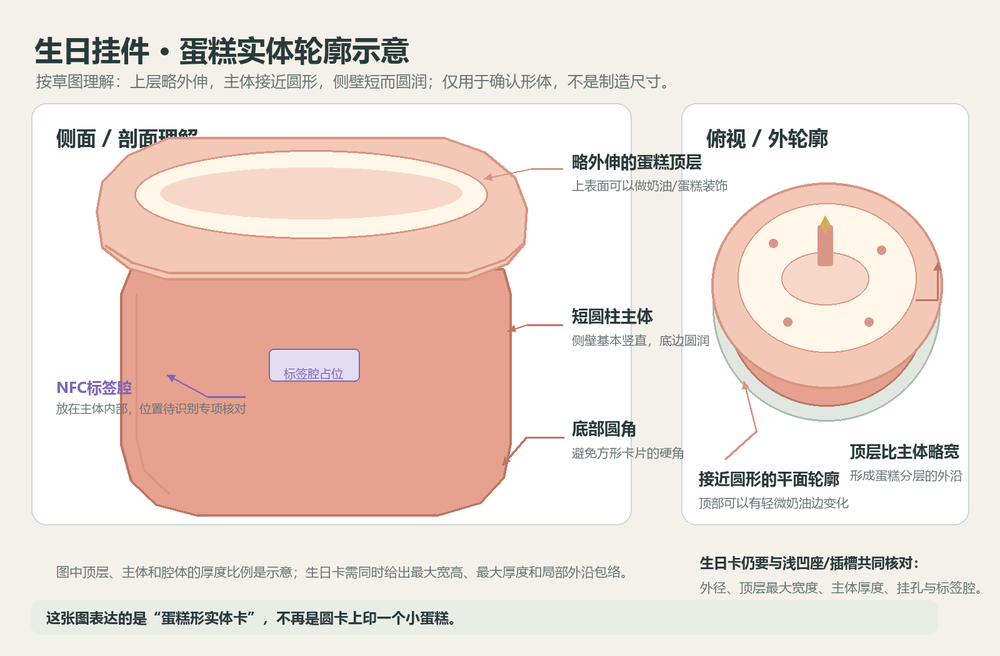
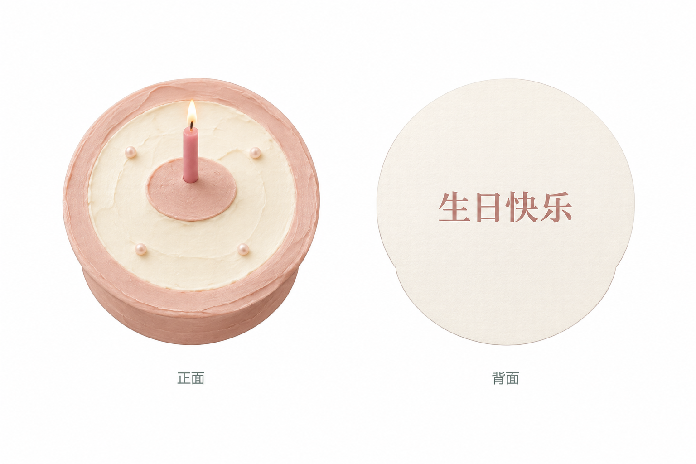
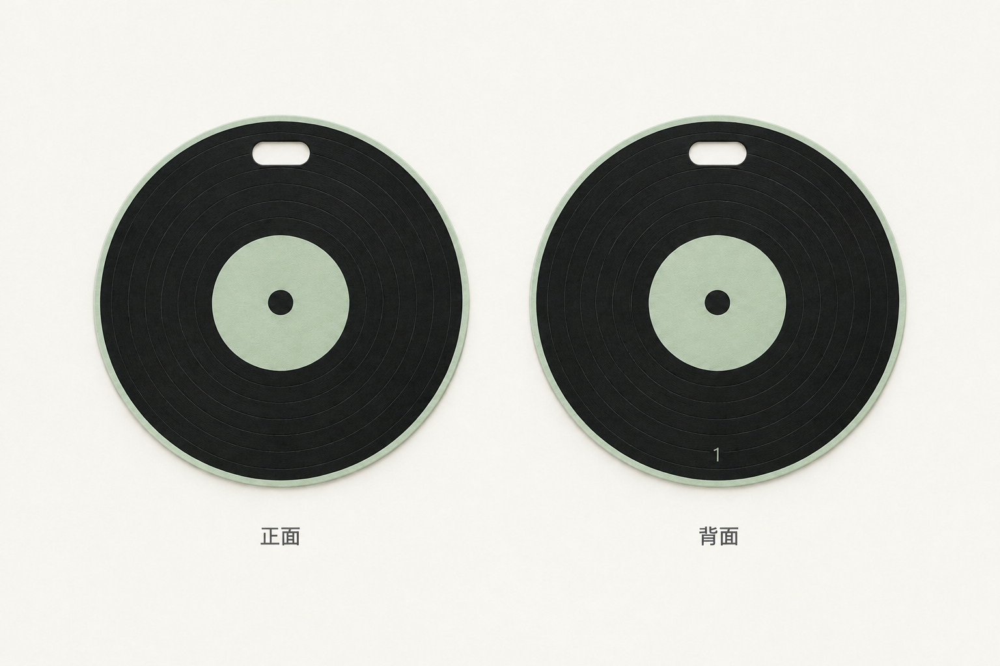
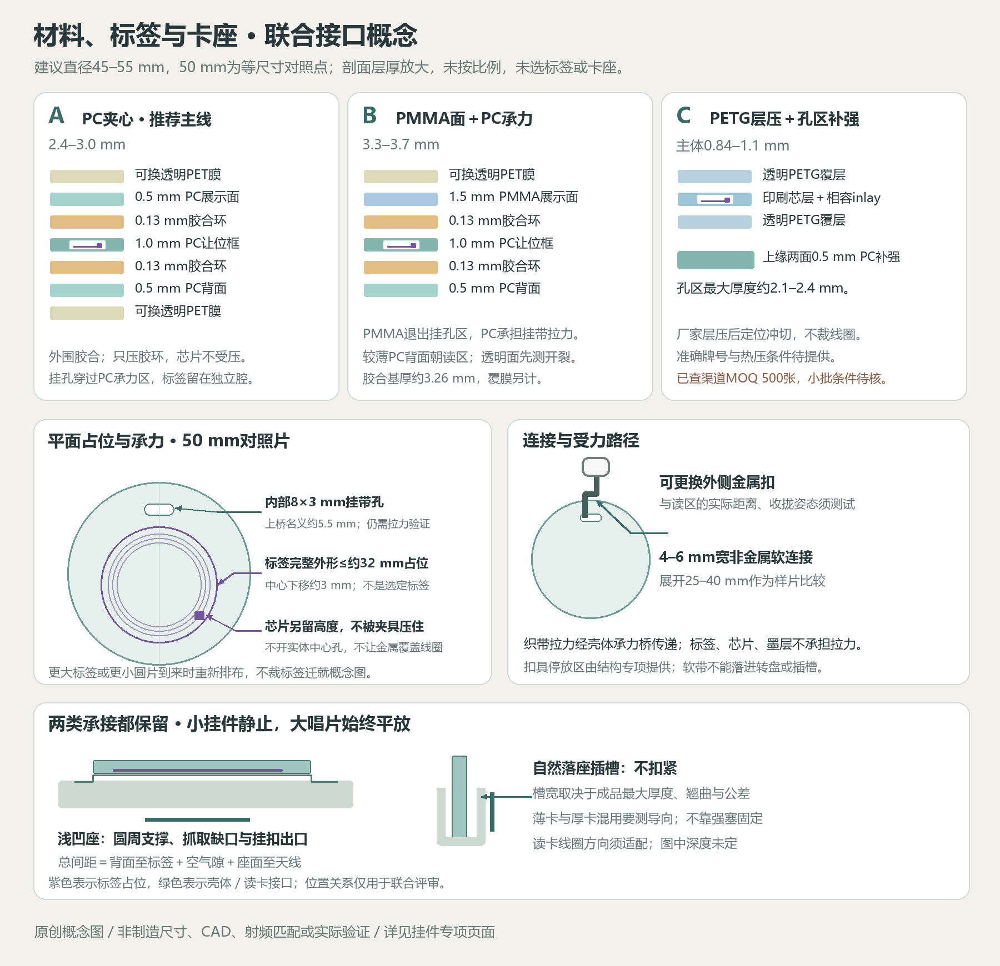
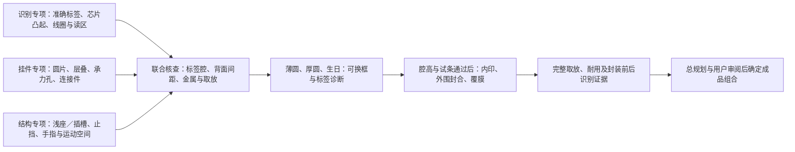

# 挂件外观、实体与材料专项

按D060独立规划八张以圆形为基础的挂件，生日卡依D065采用近圆形蛋糕轮廓；负责正反面、材料、封装、挂扣、耐用性与小批制造。2026-10-10进入少量诊断样规划，阶段为P1。用户暂留的外观沿用；下文样片数量、尺寸、材料、费用口径和筛查门槛为推荐，尚无批准的成品材料、制造文件、完整挂件报价或实物验证。

## 首轮结论与已确认范围

本轮推荐只做 **A路线的PC薄读窗、PC厚封装两种主样片**，组合为薄读窗圆片、厚封装圆卡、厚封装生日轮廓卡各1片。共用面片、背片、标签读区坐标和连接件，先分开观察厚度与异形支撑的影响；替代首轮“A两片、B两片”的起步建议。A仍是成品耐用主线的建议；已知#4033标签装不进薄档，薄读窗只作代用诊断，真实薄卡标NOT_READY并等待相容inlay。**B：PMMA展示面＋PC承力夹心**保留为后续质感备选；**C：PETG层压薄卡＋PC孔区补强**须先取得少量定制条件，既有渠道500张起订不适合八张。本轮不另扩材料候选或决定八张混用材料。

本页材料方案A/B/C与D066–D070中的唱片行为A/B/C没有对应关系；同一材料可承载任一行为类型。行为、内容绑定和取放解释见[产品行为](../../product/README.md)及[识别接口](../records/README.md#2026-10-09abc现行产品行为)，不由挂件图案、可见编号或材料决定。

八张配置依D057：邓紫棋、汪苏泷各一张，通用1–5各一张，生日0一张。各卡可用不同材质；两张歌手卡与生日0重点关注外观和耐用。生日仍只有一张卡和一个菜单入口。挂件可携带，采用无电池NFC或类似电磁感应身份（D058），原型候选见下文RC-03A，成品标签与读卡器尚未冻结。浅凹座平放、无需扣紧插槽均保留，大唱片始终平放（D056）。

2026-10-08的外观要求已登记D065：歌手图案由用户后续设计，通用卡不用明显大数字，生日卡采用下方示意图右侧的近圆形蛋糕轮廓，背面仅“生日快乐”。已确认的是轮廓与背面文字，实际厚度、内部结构、配色和装饰仍为建议；单卡图中“外观方案已确认”也按此范围理解，不表示制造设计完成。

2026-10-09用户暂留进一步的写实方向：生日卡采用写实蛋糕图案，通用卡采用真实感细密沟纹；图案不预绘反光亮带，实际光泽由材料体现。这里确认的是图案方向，不是实体蛋糕厚度、实际沟槽加工或材料定稿。

初轮PC、PMMA、PVC/PETG和PCB材料比较及职责交接见[唱片识别专项](../records/README.md#挂件实体外壳与材料规划交接由总规划安排)。本页接续实体细规格；身份、在位与取走物理事件由识别专项维护，ABC与绑定生命周期按产品行为执行，卡座与整机由[结构专项](../enclosure/README.md#三维挂件承接对照)维护。材料规划不以全面库存盘点为前置。

## 两种主样片与少量组合：2026-10-10

两档均优先询同批Makrofol DE 1-1 060048 PC片材[S1]，周边胶环采用既有3M 9472LE候选[S3]。表内单位为mm；每面保护膜0.08–0.15须为**含胶厚度**。名义加总未计印墨、材料公差、胶压缩和翘曲，不是成品最大厚度或槽宽。

05于2026-10-10补入首试圆标签Adafruit #4033，标称Ø25×0.9 mm[S7]。据此将厚框由1.0改为1.5 mm诊断起点，薄框保留为不封入标签的薄读窗对照；真实薄inlay仍等待05输入。S1已核范围只覆盖0.5–1.0 mm片材，**1.5 mm单片PC框的准确牌号、小片供货和公差待核**，不把它写成已供货的同牌号规格。若仅能用1.0＋0.5片材叠框，中间胶层、承力与实际腔高另记，重新计算总厚度和费用，不沿用单片名义数。

| 主样片 | 从正面到背面的名义层叠 | 两面覆膜后的名义厚度 | 标签腔的条件与用途 |
|---|---|---|---|
| A薄读窗 | 0.5 PC／0.13胶环／0.5 PC框／0.13胶环／0.5 PC；基础1.76 | 1.92–2.06 | 名义内面间隙0.76；不封入#4033，只比较读区侧薄层、孔桥和卡座手感。不是0.84–1.1 mm制卡薄卡或完整NFC封装的替代验证 |
| A厚封装 | 同面片、胶环与背片，框层改为1.5 PC；基础2.76 | 2.92–3.06 | 名义内面间隙1.76；#4033标称0.9 mm且加固定胶至少需约1.1 mm，1.5框仅作诊断起点，仍须按实际最高点保留0.2自由高度。用于圆卡和生日异形封装对照 |

实际内面间隙 `H_gap` 由框层与两侧胶合后的内面位置测定；装腔高度 `H_load` 包含完整标签最高点及自带背胶、额外固定胶、载片/诊断纸图、占腔的印墨，不能重复或漏计胶层。条件为 **`H_gap − H_load ≥ 0.2 mm`**，且面片在装配与取放中不接触芯片。按名义数值，薄读窗/厚封装的`H_load`上限分别为0.56/1.56 mm；05已给#4033标称Ø25×0.9 mm，但实际芯片最高点、胶层和翘曲仍待来料测量。薄读窗不封标签；厚封装若不满足就换框继续诊断，不靠压芯片、裁标签或灌胶维持厚度。

| 壳体组合 | 数量 | 外形与控制变量 | 先解决的问题 |
|---|---|---|---|
| A薄读窗圆 | 1 | 50 mm圆片，0.5 mm框层；不封入#4033，与厚圆共用孔位、背片、覆膜和标签坐标 | 薄层对读区、卡座手感、孔桥与弯折的影响；不把代用薄层称作薄卡成品 |
| A厚封装圆 | 1 | 同直径，1.5 mm框层，使用#4033可换载片 | 真实标签封装、背面优先读距和挂带承力；实际厚度、翘曲与芯片禁压另测 |
| A厚封装生日 | 1 | 保留已确认轮廓，1.5 mm框层，最大宽50 mm等比例占位；现有SVG外轮廓换算最大高约50 mm | 异形下缘支撑、上缘孔桥、胶合环连续性与手指取放；不把外形改成标准圆或厚圆柱蛋糕 |

合计**3个壳体＋薄/厚两组边角料试条**；每组各1条胶合剥离条、1条具有相同孔桥的拉力条，共4条。三片不是八张正式卡的追加名额。先用透明诊断面片、可换非金属标签载片和0.5/1.5框层；外围可拆非金属定位夹具仅用于装腔/读区诊断，须单独记录包络，带夹具结果不计为完整卡座取放证据。准确标签已可按#4033准备，但芯片局部最高点未测前不永久封合；不等待两张歌手图稿或八张正式排版。

图案保护沿用“透明面片内侧印刷＋白底、外围3–4 mm无墨胶合环＋外侧可更换透明PET膜”。诊断图可先用可拆纸图，胶合试条覆盖实际PC/胶、黑墨/白墨边界；内侧印刷、外膜和标签载片占用的厚度均需记录。写实沟纹只作印刷纹理，不预绘高光或开实体沟槽。**不预绘光泽不等于用户已选哑光材料**：初批两档用相同表面组合，光面/哑面膜的手感、清晰度和更换成本留待小片审阅。

## 八张卡的共同视觉与正反面

本轮改为每张卡独立维护正反面概念图，避免八张卡挤在一张总图中：

| 卡片 | PNG预览 | 可编辑SVG |
|---|---|---|
| 邓紫棋 | [单卡预览](../../assets/concepts/charm-card-gem.png) | [SVG](../../assets/concepts/charm-card-gem.svg) |
| 汪苏泷 | [单卡预览](../../assets/concepts/charm-card-silence-wang.png) | [SVG](../../assets/concepts/charm-card-silence-wang.svg) |
| 通用1 | [单卡预览](../../assets/concepts/charm-card-generic-1.png) | [SVG](../../assets/concepts/charm-card-generic-1.svg) |
| 通用2 | [单卡预览](../../assets/concepts/charm-card-generic-2.png) | [SVG](../../assets/concepts/charm-card-generic-2.svg) |
| 通用3 | [单卡预览](../../assets/concepts/charm-card-generic-3.png) | [SVG](../../assets/concepts/charm-card-generic-3.svg) |
| 通用4 | [单卡预览](../../assets/concepts/charm-card-generic-4.png) | [SVG](../../assets/concepts/charm-card-generic-4.svg) |
| 通用5 | [单卡预览](../../assets/concepts/charm-card-generic-5.png) | [SVG](../../assets/concepts/charm-card-generic-5.svg) |
| 生日卡 | [单卡预览](../../assets/concepts/charm-card-birthday.png) | [SVG](../../assets/concepts/charm-card-birthday.svg) |

共同要求聚焦实体配合：上缘内部设独立承力挂带孔，不增加外凸挂耳，**不打穿中心孔**；双面文字分别排版，不用镜像透印。通用卡保留黑胶唱片纹理与浅色中心标，不用大数字占据正面；正面不显示编号，背面只保留边缘小号1–5便于核对。生日卡以近圆形蛋糕外轮廓为主视觉，背面只写“生日快乐”，不加编号或感应说明。小编号不能与电子身份或绑定格式等同。歌手卡图案、配色和文字布局留待用户设计。图案不写死歌曲、歌单或网址。

| 卡片 | 正面具体方向 | 背面具体方向 | 色彩/表面建议 |
|---|---|---|---|
| 邓紫棋 | 用户后续设计；图中仅为空白占位 | 用户后续设计 | 不预设配色、人物/专辑元素或主题符号 |
| 汪苏泷 | 用户后续设计；图中仅为空白占位 | 用户后续设计 | 不预设配色、人物/专辑元素或主题符号 |
| 生日0 | 采用已确认的近圆形蛋糕外轮廓，顶面下方露出一小段蛋糕侧面；蜡烛、奶油及装饰细节仍为建议，不放编号 | 背面只写“生日快乐”四个字 | 暖白`#F4E7CF`、奶油白`#FFF8EA`、珊瑚粉`#D99586`为配色建议；外轮廓以专用示意图右侧为准 |
| 通用1–5 | 同一黑胶底与浅色中心标，数字不成为主视觉；本轮示意正面无数字 | 简化唱片纹与边缘小号1–5 | 中心标依次薄荷、蓝、紫、橘、灰白是助手建议；不强制仅靠颜色辨认 |

按直径50 mm审阅：通用卡背面小编号字高建议约2 mm，不占中心标；辅助字不少于约1.8 mm，歌手卡字级待用户图稿确定。生日卡背面四字按当前设计保留，不能再叠加编号或感应说明。印刷线条先按有色线≥0.3 mm、白线≥0.5 mm准备，这是已查加工商的文件要求[S4]，具体车间须重新核对。写实沟纹先作为图案审阅，实体沟槽的深度、节距、残余面片厚度及加工方式仍未定，不能从概念图直接加工或侵入标签禁压区。生日卡后续按已确认蛋糕轮廓检查下缘支撑、挂孔与标签腔，不预先用标准圆片支撑弧替换该轮廓；用最大宽高、局部外沿和实际支撑边核对浅座/插槽，不能仅用圆片名义直径表示完整包络。

[可编辑SVG示意图](../../assets/concepts/birthday-cake-profile-study.svg)。**用户已确认右侧“俯视 / 外轮廓”的形状作为生日卡外观方向**：近圆形蛋糕顶面、下方露出一小段侧面，外沿圆润。左侧较厚的圆柱及标签腔属于先前助手对草图的结构推断，未被确认为实际实体结构；后续不能据此锁定厚度。配色、装饰、标签腔、挂孔和卡座尺寸仍待设计与联合核查，图不作为制造尺寸。

### 用户暂留的写实概念

两张PNG由本项目使用 `gpt-image-2.5-sunburst` 生成/编辑，2026-10-09供用户外观审阅；不是实物照片或制造文件。通用1是通用卡系列的风格参考，其余卡不因本图自动完成设计。中心黑点为印刷图案，不是中心通孔；生日图未表达完整挂孔、封装与标签位置，实体配合仍按下文共同接口核查。先前SVG保留为版式示意，不能视为这两张位图的等效生产源文件。

## 三套完整组合

以下保留既有材料比较，A/B的让位框按#4033更新到1.5 mm诊断起点；薄读窗仅按上表换框层。B/C本轮不加入主样片订单，PMMA的透明展示收益与破裂/厚度代价、PETG的小批与补强条件仍需审阅。

[可编辑SVG接口概念稿](../../assets/concepts/charms-round1-material-interface.svg)。层厚在剖面中放大，未按比例；图中的线圈只说明位置关系，不代表已选标签或天线设计。旧图中的框层/厚度不适用于本轮#4033封装，按本页最新表格核对。

以下直径均建议先用45–55 mm作为审阅区间，以50 mm作为等尺寸对照点。它不构成卡座或标签尺寸决定。质量按“各层面积×厚度×密度”估算：PC资料值1.20[S1]，PMMA约1.19、PETG约1.27 g/cm³为计算假设，均不是所购批次的检验值。50 mm圆片面积约19.6 cm²；1.5 mm框的A/B未扣腔/孔、未计胶膜的基材质量约5.9/8.2 g。表中宽范围考虑45–55 mm、开腔、补强、胶膜、油墨和覆层，连接件暂按另加4–8 g估算；最终用准确材料资料与样片称重替代。

| 项目 | A：PC夹心，推荐主线 | B：PMMA展示面＋PC承力夹心 | C：PETG层压薄卡＋PC孔区补强 |
|---|---|---|---|
| 用途与收益 | 八张均可采用；印刷藏在透明片内，优先验证携带耐冲击 | 三张主题卡的透明质感对照；受力路径继续由PC承担 | 通用1–5的轻薄对照；关注挂孔、弯折和实际小批门槛 |
| 材料/牌号建议 | 面片/背片各0.5 mm、让位框按0.5 mm薄读窗或1.5 mm厚封装可换，优先询Covestro **Makrofol DE 1-1 060048**；官网列500–1000 μm双面光面PC薄膜[S1] | 正面1.5 mm **ACRYLITE Premium (FF)**挤出PMMA为牌号参考[S2]；中间1.5 mm或可换框和背面0.5 mm沿用A的PC。国产替代需提供制造商、牌号与板厚公差 | **制卡级PETG芯层＋同体系透明PETG覆层**；具体牌号、软化/层压条件和耐候资料待厂商提供[S5]。不能把普通PETG板材或3D打印耗材当作制卡覆层 |
| 名义层叠 | 0.5 PC／0.13胶／1.5 PC让位框／0.13胶／0.5 PC；基础约2.76 mm（薄读窗另换0.5框） | 1.5 PMMA／0.13胶／1.5 PC让位框／0.13胶／0.5 PC；基础约3.76 mm | 透明覆层／印刷芯层与NFC inlay／透明覆层；由厂家安排芯片缓冲与局部让位，不预设家用热压参数 |
| 覆层与名义厚度 | 两面可换透明PET膜各0.08–0.15 mm含胶；厚封装名义2.92–3.06，薄读窗1.92–2.06；实际最大厚度待测 | 同膜名义3.92–4.06，实际板厚公差另计；增加框层后不沿用旧3.3–3.7 mm范围 | 薄卡主体建议0.84–1.1 mm；孔区两面各0.5 mm PC补强＋胶，局部最大约2.1–2.4 mm；相容薄inlay未齐前为NOT_READY |
| 圆片质量；含连接件总质量 | 本体约4–8 g；含软连接及外扣约8–16 g | 本体约6–10 g；完整约10–18 g | 本体及补强约2–4 g；完整约6–12 g；不能用薄卡轻量推定能驱动在位开关 |
| 切割/边缘 | 薄片刀切或CNC/铣切框层；刀口修整、圆滑倒边，挂孔内壁抛顺。PC不默认采用CO₂激光切割 | PMMA比较激光或CNC，PC层用A工艺；首样优先机械修边，胶合边不作火焰抛光。PMMA不跨挂孔承力桥 | 印刷后层压、再按inlay位置冲切/铣切圆片；冲切不能切到线圈。孔区补强片圆角，清除毛刺 |
| 印刷与连接 | 透明片内侧反向UV彩印＋白底；留3–4 mm无油墨胶合环。优先模切 **3M 9472LE** 0.13 mm压敏转移胶[S3]，贴在洁净PC表面，不将其当作已验证结构胶 | PMMA内面印刷，透明外圈约3–4 mm；PMMA只作展示面，PC框与背片形成承力孔。同胶膜先做PMMA/PC粘接对照，确认不发雾、不裂、不开边 | 胶印/数字印刷、白底和配套覆层；厂家热层压封装，局部PC补强采用单独验证的压敏胶。首轮不采用金属铆眼 |
| 标签固定/芯片让位 | 厚档#4033用非金属载片固定在背片内侧，框层全包络开腔；只压外围胶合环，不压芯片。薄读窗的标签托外置，不冒充已封合 | 同A；背面仍为较薄PC，标签朝背面读区。透明图案窗口不意味着裸露芯片 | 采用厂家相容的裸inlay与缓冲结构；普通背胶贴纸不直接送入热压。由识别专项核对芯片/线圈及封装工况 |
| 挂扣承力 | 上缘内部圆角挂带孔穿过全部PC层，织带受力分散到壳体，不接触标签腔 | PMMA在孔区局部退让；挂带只接触PC承力桥，正面不承担挂孔拉力；共同孔位不代表三层都打同一个孔 | 穿孔仅在无线圈上缘，两面PC补强分摊拉力；补强片与PETG粘接及剥离是关键试验。若不通过，不用金属环补救代替重设计 |
| 主要取舍 | 未硬化PC仍会刮花；边缘胶合和贴膜需要维护，耐冲击方向须实测 | 更厚、更易出现应力裂纹和展示面碎裂；多一种材料和加工设置，不因透明漂亮直接选定 | 局部薄卡强度、翘曲、补强分层与不同图案起订量；目前500张MOQ渠道不适合八张 |

两套胶合方案均先验证胶对实际油墨、PC与PMMA的相容性。未经样片，不采用瞬干胶、溶剂灌封或整腔环氧滴胶：透明雾化、应力开裂、固化收缩与芯片受压会使问题难以定位。原厂运输保护膜不是成品耐刮膜；可更换膜也不是已获得硬度等级的硬涂层。若改用硬化PC面片，需另核准确牌号、可印面及胶合面，重算厚度与费用。

PVC作为C的制卡供应替代继续留在原比较，不新增第四套；PVC/PETG不可在未核实胶层和热压条件时混叠。FR-4 PCB外观本轮不进入样片主线：铜图案、自研天线、芯片焊接和板边封装会增加识别及制作任务。若用户喜欢电路图案，优先在A的非导电印刷层表达，再评审是否有必要使用真PCB。

## 标签、挂扣与卡座共同接口

以下为**06→05识别／04结构的本轮参数表**；尺寸均为样片建议或概念换算，准确物料与实测字段显式待补。以圆片中心或生日外轮廓包围盒中心为原点，12点为`+Y`、正面朝上；背面为优先读区。保留20/25/30 mm完整圆标签比较空间，先用不大于约32 mm、中心向6点偏3 mm占位。这里包括完整基材/胶层，不只是线圈；矩形或较大标签须重新排布。

| 参数/参考面 | 06当前交回值与性质 | 等待输入或联合核查 |
|---|---|---|
| 外形与支撑边 | 薄/厚圆均Ø50；生日最大宽/高约50×50，来自现有SVG374×374外轮廓等比例换算，非实测/刀路 | 04按生日原轮廓6点方向连续下缘核对支撑、止挡和防倾斜；不能把同宽高等同于标准圆，不能为卡座配合削平下缘 |
| 最大厚度/翘曲 | 两档名义覆膜厚度见上表；可先以薄读窗2.3、厚封装3.5作卡片占位厚度预留，孔区暂与主体等厚，无金属铆眼 | 替代旧厚卡3.0预留；预留不是加工公差、实测上限或槽宽。材料/墨/胶/膜实际最大厚度、翘曲待测，04另计游隙，超占位值时回交更新 |
| 挂带孔/承力桥 | 孔中心`(0,+18)`，圆角孔8×3、端部半径1.5；50 mm圆片中线上桥5.5，局部最薄桥目标≥5 | 圆卡两侧曲边与生日上缘须重核最窄桥；孔下缘到标签腔、无墨胶合环及刀具偏差共同检查。45 mm片不能等比例套用此孔 |
| 完整标签/芯片 | 05首试Adafruit #4033 NTAG213，商品标称Ø25×0.9 mm[S7]；公差、芯片局部最高点/坐标、线圈深度及允许温压/弯曲值**等待05** | 0.9是整片商品厚度，不能当裸芯片高度；不以20–32概念范围或40×25协议贴纸代替来料包络。读卡端25×10/50×40天线不是卡内标签 |
| 标签腔/可换框 | 标签每侧先留0.3–0.5装配余量；#4033按标称先取腔Ø26、中心`(0,−3)`诊断占位；框0.5/1.5可换 | Ø26不是冻结尺寸。旧1.0框理论内面间隙约1.26，仅当含胶/载片等`H_load≤1.06`且公差/受压通过才可用，当前不据此放行；厚档先用1.5框、至少1.5实测腔高。生日胶合宽度和禁压区另核 |
| 标签固定/载片 | 可换非金属载片固定在背片内侧，不揭拉标签来换框；材料与含胶厚度随05实物记录 | 载片、固定胶和内墨占腔厚度纳入`H_load`；永久封合前撤去诊断夹具并复测。换载片不能隐瞒读区位置改变 |
| 读区层叠 | 分开记`d卡`＝线圈到所用卡面、`d座`＝读卡线圈到座参考面、`g`＝空气隙；总间距`D=d卡+d座+g` | `d卡`含标签内部线圈位置、固定层、0.5背片、印墨/覆膜；准确值等待05。04交回`d座/g`。共背片的厚薄样未必改变背面读距；翻面时重新合算，05另扫新增0/1/2/3间隔 |
| 软带 | 先统一4 mm宽、0.4–0.6厚软织带；6 mm宽仅在孔内余量与拉力支持后比较。孔外有效非金属长度先取25/40两档 | 有效长度从孔上缘量到首个金属件，不是下料总长；回折、缝合/接头、双层穿孔厚度及承力需核。04给软带出口，05扫描收拢后金属靠近读区的姿态 |
| 金属扣/自由包络 | 沿用外侧可替换小扣，供货前暂用“含连接环总长20–30、宽10–15、厚4–6”的占位盒 | 准确扣型、材质、最大外形、开口/连接环和质量待核。软段40＋扣环总长30时，孔上缘起最大伸展先按约70范围占位；这是自由包络估算，不是NFC安全距离，实际姿态须复核 |
| 孔区/质量 | 初样无额外孔区补强层；50 mm圆片未扣腔/孔的PC质量，薄读窗/厚封装按密度1.20 g/cm³[S1]估算约3.5/5.9 g；胶/膜/标签另计，连接件4–8 g仍为假设 | 整件/连接件分别称重，生日按实际轮廓面积另算。胶环与PC孔桥承力，不能把标签当受力件；B/C另交局部厚度/承力路径，轻片不靠重量默认驱动开关 |
| 浅座/自然插槽 | 三片共用非金属可换支撑/导向对照；下缘自然落座，孔/软带留在外露部分 | 04提供座深、下止挡、导向/游隙、可抓取边、软带出口/扣具停放区、线圈方向与手指路径；不夹紧薄卡，不靠强塞厚卡 |
| 材料/图案保护 | 普通非导电色墨、内部白底、外侧可换透明聚合物膜；不印高光、不刻槽 | 胶对实际PC/油墨、膜的粘接/换膜和分层待验证；金属化膜/金属粉不进入首样。铁氧体仅在05定位需求后联合重算厚度 |
| 整机避让 | 卡片、软带/金属扣自由摆动、收拢及手部包络一起交04 | 04结合09水平转盘/轴/传动/灯最大扫掠区核位置，扣具不得垂入运动区。诊断夹具不得被当成正式挂件包络遗漏 |

### RC-03A标签与读卡天线试验交接（2026-10-10）

现行识别路线按D091采用自制PN7160 B版：核心板45×32 mm、分离天线板44×44 mm，准确厚度、接头及安装净空仍按B版工程回填。历史`PN7160_MINI_I2C`及其25×10/50×40 mm商品天线仅作可选对照；读卡端天线属于本体，不能塞进挂件或当作标签尺寸。挂件身份层保留Adafruit #4033 White Tag NTAG213作为诊断候选，商品标称Ø25×0.9 mm、3枚用于同片/换片/邻片与未绑定对照；芯片局部最高点、标签公差、线圈深度及国内到手价仍待核。#4033可用于厚腔诊断，不能证明真实薄inlay或最终八张封装卡；不裁标签来迁就腔体。

向识别专项交接两款可调整承接结构共用的样片表：标签完整外形、线圈方向、芯片凸起/背片到读卡线圈总间距、挂扣金属位置、偏心/倾斜及生日卡实际连续支撑弧；标签更换或材料封装后，需重新验证读区与B驻留行为所需的可信离座事件。与大唱片转动区隔开，不能通过削切完整标签或把线圈压在挂扣下迁就外观图。

## 实现对话的样片与验证安排

第一批按上表**三个可调整PC壳体**交接，识别与卡座共用。先用同一枚#4033在厚圆/厚生日之间轮换；薄读窗用外置可调非金属标签托保留足够腔高，按同一读区坐标、实际线圈间距做薄层对照，带托结果不计为封装卡取放通过。尺寸与芯片让位通过后，厚圆/厚生日才全周胶合、内印和覆膜，撤去诊断夹具，记录实际厚度再做完整取放及耐用筛查。两厚片永久封合各需1枚同型号标签，薄读窗借用第3枚；05本轮先3枚诊断UID，最终T02再覆盖八张正式身份和未绑定样本。邻片先1枚，后续借共用标签扩至7枚，不要求先造八个外壳。

实现时先完成PC裁片/换框与空壳配合，再用准确标签检查装腔和读区；薄/厚试条的胶合与孔桥通过后，确定印墨/保护层，只压外围封合，最后核对完整取放、耐用后的读取。胶合温压与静置时间按胶厂条件核对。每片保留材料/胶/膜批次、实际厚度与翘曲、腔高、芯片方向、质量和加工条件，试样编号放外置记录签，生日背面仍仅四字。B只有在用户希望比较透明质感时另备PMMA/PC小试条；C只有小批与层压条件齐备后另行安排，不与本批合单。

下表均为**工程筛查建议，非已通过结果或认证**。同一方案的耐用试验可按顺序在一片上累积；出现失败后用独立复样定位根因，不能把一个累积失败归因于最后一次试验。破坏后的样片不作为正式卡交付。

| 验证 | 条件与记录 | 建议进入下一轮的判据/方案重点 |
|---|---|---|
| 外观与印刷 | 先查生日原轮廓和现有通用图的1:1效果，不等待歌手图稿；对比透明诊断面、内印试条及覆膜前后，在白底/深底和室内光下检查胶边、墨层、细密沟纹、小编号与四字 | 没有影响阅读的偏位、胶溢、白底缺口或大气泡；沟纹的印刷分辨率由车间小样确认，不以PNG细节推定印得出。图案不加反光亮带，实际反光与手感由用户看材料小片 |
| 尺寸与取放 | 各片测外径、最大厚度、孔区厚度、翘曲与质量；两种卡座各做50次自然取放，带外扣、翻面、轻偏斜；记录卡住/晃动/刮痕 | 不需要扣紧，无卡住和外扣干涉，姓名/编号可见；实际配合尺寸由结构复核。C不能依靠夹紧实现稳定，A/B不能靠强塞入槽 |
| 跌落 | 完整挂件从1.2 m落到明确记录的硬质地面，正面、背面、边缘各2次；每组检查并重读标签 | 无裂口、锐边、脱层、脱扣或标签失效；A看胶边开口，B看展示面及孔区开裂，C看鼓包/折痕；失败则调整材料/承力再测 |
| 刮擦与图案耐久 | 干净棉布往返200次；另用同一枚圆滑钥匙、约2 N载荷划20次，记录接触面与可更换膜；正反面各拍斜光对照 | 不露出标签、图案不脱落且编号可读；允许牺牲膜轻划痕，但记录换膜后本体是否损伤。不将此手工对照换算为铅笔硬度等级 |
| 挂孔与连接件拉力 | 每套小试条及完整件分别做20 N保持60 s、10 N往返100次；观察孔桥、胶边、织带和扣。保护夹具固定壳体，避开标签腔 | 无孔桥裂纹、层间滑移/张口、织带割伤或扣脱开；记录孔延伸和残余变形。B确认PMMA不受挂带点压；C看补强片剥离。测试值须与携带用途联合审阅 |
| 分层/湿热 | 常温干燥基线对比40°C、约75%RH、24 h筛查及湿布擦拭；记录实际环境，恢复2 h再检查和拉力/读取。胶合试条对比干态与处理后剥离，记录失效在胶、油墨还是基材 | 不出现持续扩展的开边、芯片周围鼓包或新裂纹；不宣称防水或长期耐候。B重点温差/溶剂接触裂纹；C重点热层压与补强层分离 |
| 薄档弯折/芯片受压 | 先查薄壳面片在取放/拉带时是否碰芯片；05给出inlay允许弯曲条件后才安排弯折，记录半径/方向/次数 | PC可弯不代表标签可弯；不点压芯片。不出现裂线圈、芯片失效或永久折痕。C以后加入时另按厂商层压/补强条件测试 |
| 封装前后识别 | 同一标签先裸读、装腔未封、封装后再读；两类卡座各测正反方向与读区边界，外扣自然垂放/靠近/收拢、7张邻片、运动停止/启动；耐用试验后复测 | 与识别专项共用取放事件测试，建议每组合先50次有效放入/取走，记录成功率、延迟、漏读/错读；身份不得串成邻片，同片在位不重复发放入事件。具体读区/延迟通过线由识别专项和总规划确认，ABC播放动作另按产品行为联测 |

“读到身份”与“确认在位/取走”分别记录；任何材料、背片、贴膜、连接件或铁氧体改变后，重测受影响的识别条件。图示、裸标签读取及某一张样片通过，都不等于八张完成耐用/端到端验收。

## 可公开来源、加工渠道与费用边界

S1、S3的原厂厚度/材料资料及S7首试标签商品规格已于2026-10-10复核；其余沿用2026-10-08记录，价格/MOQ不是本轮有效定制报价。以下区分原厂资料、加工商公开条件和待询价，尚无完整挂件书面报价。

| 来源 | 本轮已核实的内容 | 适用范围/仍待核实 |
|---|---|---|
| [S1 Covestro Makrofol DE 1-1 060048](https://solutions.covestro.com/en/products/makrofol/makrofol-de-1-1-060048_000000000000327075) | 官网说明PC挤出薄膜、双面光面和标准保护膜；厚度500–1000 μm，资料密度1.20 g/cm³ | A/B片材牌号及质量估算参考；不是硬化PC。国内零切/批次公差和价格待询，资料值不是购入片材检验值 |
| [S2 ACRYLITE挤出板厚度公差](https://www.acrylite.co/resources/knowledge-base/article/what-is-the-thickness-tolerance-of-acrylite-r-extruded-ff-acrylic-sheet) | 官方表中1.5 mm档对应0.060 in，厚度范围0.054–0.066 in（约1.37–1.68 mm） | B的PMMA参考；说明不能按名义板厚配紧槽。国内替代、修边公差和实际厚度待询，不混用铸板公差 |
| [S3 3M 9472LE转移胶](https://www.3m.com/3M/en_US/p/d/b40071705/) | 官方产品为300LSE体系转移胶，5 mil/0.13 mm；说明异材粘接和抗翘起用途 | A/B无墨胶合环初样候选；不保证透明光学外观、结构承力、PC/PMMA/墨层适用或防水。国内原材、模切和胶合工况待核 |
| [S4 Vograce双面透明亚克力挂件](https://vograce.com/products/custom-clear-acrylic-keychains) | 产品资料MOQ 1件、CMYK；50.8 mm、双面不同图、无附加工艺公开选项价 **US$2.97/件**；文件要求300 dpi、1000像素以上、白线>0.5 mm/色线>0.3 mm | 可买印刷对照样，**不是B的夹层NFC挂件**；不含自定义标签腔、PC承力背、胶合和补强验证。是否接受分层零件/孔区要求、牌号与板厚待核 |
| [S4a Vograce交期/运费计算器](https://vograce.com/pages/shipping-production-time-cost-calculator) | 交期/运费需选产品、规格、目的地及数量；确认效果稿时间不计生产时间，超过5件可在2–5工作日提供效果稿后安排生产 | 本轮未取得选定目的地的计算结果，生产/运输天数和运费待核；2–5日是效果稿时间，不是制造交期 |
| [S5 创新佳PETG RFID卡](https://www.nfctagfactory.com/products/rfid-petg-smart-card.html) | 供应商页列PETG、13.56 MHz、85.5×54×0.84 mm或定制、**MOQ 500张**；可申请免费样品 | C存在制卡渠道及起订门槛；免费样品是否定制、圆形/八图起订规则、牌号、inlay/层压、交期和价格未核。不采用其通用读取距离宣传作本项目依据 |
| [S6 嘉立创一站式制造入口](https://www.jlc.com/) | 官网列面板定制、CNC、PCB等服务与在线计价入口 | A/B裁片/框层询价入口；是否接受0.5–1.5 mm薄塑料片、可用PC/PMMA牌号、UV印刷/分层装配待核，不能由“有CNC”推定可一站完成 |
| [S7 Adafruit #4033 White Tag NTAG213](https://www.adafruit.com/product/4033) | 商品标称完整圆片Ø25×0.9 mm，NTAG213、7字节UID；05本轮拟用3枚诊断 | 公差、内部线圈/芯片位置、局部最高点和固定胶未齐；不属于相容热层压薄inlay，准确最高点仍待测 |

外部商品图未复制入概念稿；本轮引用公开产品事实及链接。方案图为原创表达；后续采用照片/专辑或供应商素材时再核查来源与可公开范围。

### 同口径费用表

完整成本记为 **材料＋切割/开腔＋印刷/白墨＋胶膜/覆层＋标签＋织带/扣具＋装配/检验＋一次性设置＋运输/税费＋明确的复样损耗**。标签型号与单价由识别专项输入，不能用外壳裸价代替总价。各渠道分别报价“1张完整样片”“八种图各1张、共8张”“补做1张”；A/B图案不同可共用切割轮廓，不默认能免印刷设置费。

本批询价另列“三个壳体＋四条试条”的合计与分项：0.5 PC面/背片6张＋薄框1张、1.5 PC厚框2张，胶环6片、外膜6面、可换载片/非金属诊断夹具、软带/扣3套及试条用料；1.5框单片供货或叠框增量、备框、复样和余料另报。先报空壳/可调整诊断样，再报内印/白墨/永久封合增量；不能为报价等八张正式图案。3枚#4033与05共用预算，最多两枚用于本批厚片永久封合、第三枚供未绑定/薄读窗轮换，需长期裸标签时先留可拆壳，不重复计费。

| 路线 | 打样口径与当前费用 | 八张小批口径与当前费用 | 单张/补做费用 | MOQ与交期 |
|---|---|---|---|---|
| A薄/厚，本轮 | 薄圆1、厚圆1、厚生日1＋四条试条；可调整/封合增量和两种轮廓设置分开，金额待询 | 八图各1张，共7圆＋1生日轮廓；薄/厚分配尚未选，分别报统一厚度与混厚增量 | 单张薄圆/厚圆/厚生日各报一次；补做的材料、印刷/刀路设置与税运分开 | 指定PC零切、胶环/覆膜模切、圆/异形混批MOQ及交期待核 |
| B，后续备选 | PMMA/PC质感/胶合试条增量待询，不计入本轮3壳体 | 全B的8张与“B三主题＋A五通用”仅作后续费用比较，可能有两套材料设置 | 展示片、PC承力层、标签腔与再次开机分开 | 普通印刷挂件MOQ 1不代表本夹层组合MOQ；牌号/薄片供货待核 |
| C，条件备选 | 少量定制层压与孔区补强条件未齐，不计入首批 | 八图混单与补强均待询；不按500张凑八张 | 定制冲切/层压再次开机待询 | 2026-10-08页列MOQ 500；1–2张圆形定制例外未核，不作为现行可下单路线 |
| 外观参考S4 | 普通50.8 mm亚克力挂件1件公开选项价US$2.97 | **US$23.76＝8×2.97**仅为未计数量折扣的同规格商品价算术参考；八图合单规则待核 | US$2.97页面价，非定制NFC补做价 | MOQ 1；生产、运费/税费、配件价与最终结算待核 |

当前不能给出三套完整挂件的人民币总价或确定成本排序。工程判断是A能共用材料/轮廓，B增加展示面和一种加工设置，C可能因起订/冲模抵消薄卡节省；待同口径报价检验。首批不推荐注塑开模、烫金、金属化全息膜或整腔滴胶，先用普通非导电印刷和片材组合验证必要收益。

**费用缺口**集中在指定PC小片供货/公差、两种轮廓与0.5/1.5两档框层加工、9472LE零切/模切、保护膜含胶规格与换膜费用、薄读窗/厚圆/厚生日各件装配检验、#4033标签及后续相容薄inlay、扣环、夹具/试条/复样、混图设置和税运交期。原材料用量只能用于同口径询价；没有单价时不填人民币估算总额。S4的US$2.97及8倍算术保留为历史普通商品参考，不作为NFC样片预算，也不保证今日价格。

### 后续询价的有效条件

实现对话使用审阅后的轮廓和层叠文件询价，注明：直径/允许公差、双面八种图、各层牌号/厚度/公差及实际最大厚度、无墨胶合环、标签完整包络/芯片凸起、芯片禁压、非金属孔区承力、普通色墨/可更换膜、去毛刺与样片验收方法。明确标签由谁提供/装配、能否按批准inlay制作，不经审阅不得换芯片/材料。

报价拆分1/8/补做1张、同图与混图MOQ、余料归属、模具/开机/印刷/模切/装配/检验、挂扣、税运、废品/复样责任、效果稿/实物确认、生产日/运输日及有效截止日期。商品起价、原材零售价、免费样片、免费PCB券或“可定制”宣传均不能成为本项目有效总价。

## 需其他专项提供的接口与待用户审阅项

| 对方 | 需要提供的具体输入 | 本专项返回/联合检查 |
|---|---|---|
| 05唱片身份与识别 | 优先给准确圆标签型号/完整尺寸、芯片坐标/最高点/允许温压弯曲、固定层与线圈位置；给两天线读区、金属姿态、测试口径及国内价格 | 上表两档腔高、可换载片/框层、独立读距和连接件包络；薄档条件不满足时回交，不裁标签或把读卡天线装进卡内 |
| 04结构与声学 | 优先给两类卡座参考面、实际支撑弧/下止挡、露出可抓取边、游隙/导向、软带出口/扣具停放区和`d座/g`；结合09运动包络 | 三壳体的圆/生日轮廓、薄/厚/孔区厚度预留与待测项；独立卡座取放、挂扣及异形支撑对照，不靠夹紧/强塞通过 |
| 总规划 | 联合核对准确标签与薄档可行性、三样片与两座配合、金属/运动与读区取放；组织样片分项报价与材料手感审阅 | 两种以内主样片、三壳体推荐、费用缺口和待测参数；表内占位/名义加总不是冻结制造尺寸 |

待用户审阅的实质性取舍：

- **PC薄/厚的携带手感**：推荐先按三壳体对照；薄读窗与厚封装的名义总厚度相差约1.0 mm，边缘/软带舒适度与芯片保护必须同时成立。薄读窗不封标签，厚档芯片装不下时换框，不以轻薄目标牺牲让位；正式尺寸与样片费用批准仍待准确输入。
- **材料实际表面**：光面或哑面保护膜、透明边的保留程度与换膜维护，需材料小片和分项费用支持。用户只确定图案不预绘高光，未决定实际材料无光泽；本轮不重新问蛋糕装饰或等待歌手图稿。
- **是否值得加PMMA质感对照**：默认不加入第一批完整壳体；只有用户希望比较且胶合/耐用/卡座输入支持时另报B增量。八张全PC或主题卡用PMMA的成品取舍留待有效报价与样片证据，不替用户选择额外费用。

本轮只更新本页，已有概念图与工程原位保留。样片CAD、加工文件、实物筛查和采购在专项实现获授权后执行；Git由总规划协调。
