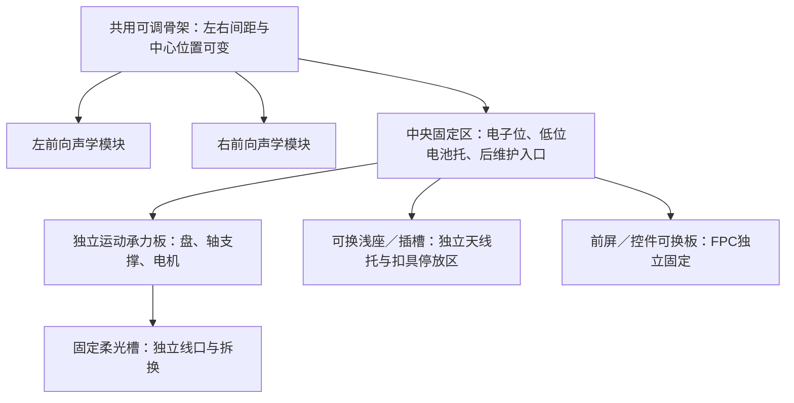
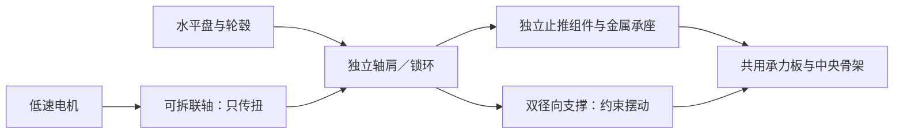
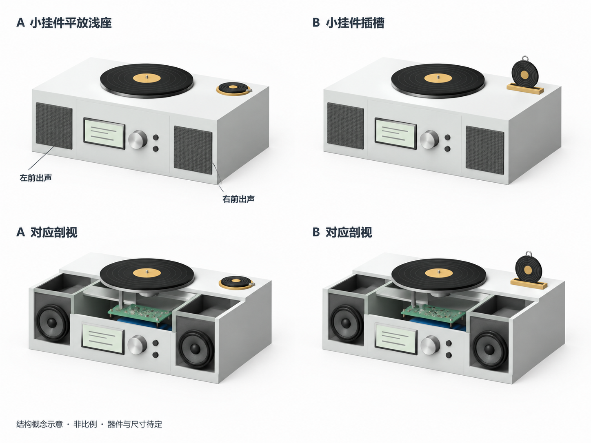
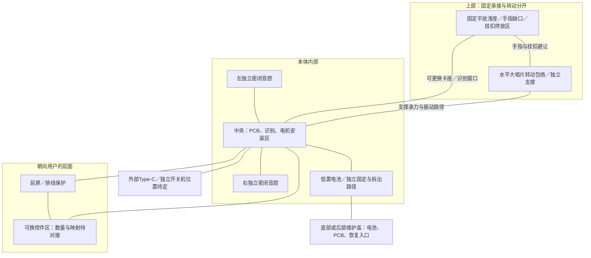
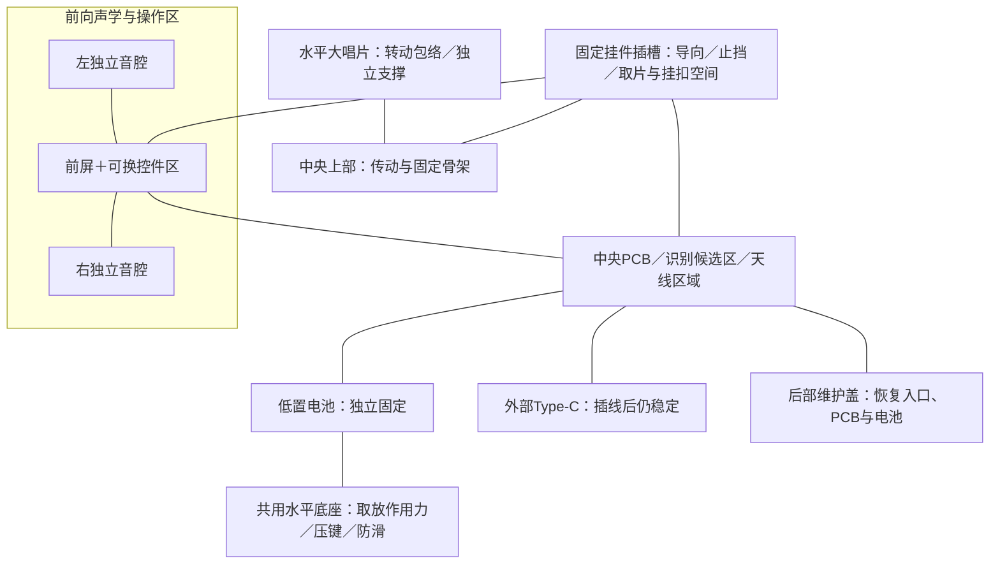

# 结构、音腔与成品材料专项

对应 F03、F06、F14，以及整机体量和音质目标。结构规划必须把挂件、识别线圈、左右音腔、前屏、电池、PCB、Type-C、运动间隙和维护路径放在同一布局中检查。

**2026-10-14共同入口：** 外观分支的奶油白＋胡桃木、视觉居中、右后圆形展示台与齐平低环按审美层级保留，实际材质、尺寸和S1/S2托芯继续待验证。[L3空间研究](../../mechanical/studies/l3-v01/README.md)是400×260×134 mm壳体、最高152 mm的独立研究输入；它与下文SW V3的356×210×108／336×202×108 mm候选并列，不能按提交先后替代或冻结成品尺寸。两组模型都需回填真实电子布局、NFC天线、紧固及声学/维护证据。

**方案 A · L1 视觉居中优先（2026-10-10，待审阅）**：本分支已形成[横向一体式三视图、可换卡座对照与 L2 证据门槛](concept-layout-a-l1.md)，对应[上一轮 L0 空间架构](concept-layout-a-v0.md)。此项记录的是用户选择的**草图深化优先级**，不新增 D 号产品决定，不冻结成品尺寸、控件、卡座、材料或模块；图为示意而非真实尺寸／装配验证。

**外观／外壳专项 CMF v0.1（2026-10-10，待审阅）**：已新增[通用版外观、可制造分件、CMF 样片与可替换生肖礼物主题规划](appearance-cmf-theme-v0.md)。这只是用户倾向的通用外观继续规划，不代表生肖类型、外观材料、控件、真实尺寸或生日卡改版已获批准；生图生成的尺寸／猫摆件不构成输入。

**L2 真实部件包络与小批外包结构（2026-10-10，资料核查／可审阅）**：已形成[候选尺寸来源登记、声学 Q/V 两路线、转盘／卡座／电池／屏幕包络冲突及分件外包门槛](layout-a-l2-envelope-and-outsourcing-v0.md)。此项只建立工程尺寸来源与求解流程；图示尺寸不采用，整机 CAD／制造文件与实物干涉、音质及 NFC 测试均未完成。下一步先补唱片/传动、音腔、屏幕与取放操作的准确包络后再制作可询价分件。

**L2A 当前外观组合（2026-10-10，用户审美选择）**：已选择**奶油白＋胡桃木**与**右后圆形展示台**，详见[圆台可换托芯、NFC/RF 风险、视觉居中几何算例及声学/转盘/外包分件深化](l2a-cream-walnut-circular-display-v0.md)。T1装饰环建议非金属，S1平放浅座与S2自然落座浅槽均保留；本轮只推进资料设计和约束研究，不冻结任何实物尺寸、音腔、元件或工艺。不修改现行D号。

**L2A 齐平低环已选择（2026-10-10，仅审美）**：保持奶油白＋胡桃木、视觉居中和右后圆形展示台，用户进一步选择 **A：齐平低环** 而非微抬台。见 [圆形低环的分件层叠、S1/S2可换托芯、NFC/旋转/右音腔避让及首批外包试样](l2a-flush-low-ring-v0.md)。现有 72 mm 圆环只是历史假设；高度差、环径、材质与实际结构仍未冻结，两条声音路线和八张挂件/蛋糕生日卡保留。尚无可制造 CAD 或任何实物通过。

**P-L01 小批外包拼缝试片设计准备（2026-10-10）**：已形成[齐平低环／木纹板两种收边路径、参数与尺寸链、试样分件、RFQ及 QA 计划](p-l01-flush-ring-sample-spec-v0.md)，优先比较易加工的贯通孔细阴影缝，台阶遮边作为条件备选。仅文档完成；试片 CAD、供应商评价、报价和实体工艺测试均未开始。不把拼缝外观 QA 当作 NFC、声学或整机结构通过。

**P-L01 数值化研究模型（2026-10-10）**：已生成[完整可修改参数工作值、CAD 几何有效性核对和实物限制记录](p-l01-numeric-parametric-study-v0.md)；CadQuery 源码、研究 STEP/STL/DXF 随当次对话提供，按 D086 不作为已实测模块上传公开仓库。仅完成试样外观几何，不保证定位座防脱、NFC/声学/装配通过，未发加工报价。

当前阶段主控为S3模块验证、S31成品主线（D063），参考开发板尺寸不作为成品主板尺寸。音频与结构按D064共同验证音质/性价比两套声音模块、约1米听距；按D065核对近圆形蛋糕生日卡的最大宽高、实际支撑边、挂扣与标签包络，不能只用标准圆片直径代替卡座配合。

## V3候选模型实施：2026-10-10

用户已授权继续实际SW建模；采用Python COM，原生工程与复现、预览及验证证据暂留本机。V3已生成106个独立原生零件、8套固定装配（5套布局与3套关键剖半）及32张实际SW视图；零件单实体／无Fix完全定义、装配保存重开／引用／位姿及已建实体零干涉检查完成，预览已目视复核。基准356×210×108 mm、紧凑336×202×108 mm均为候选壳体尺寸，不含脚、前网罩、大盘及卡座。

两候选保持每侧80×98×172 mm原始腔和120×90 mm主板占位；紧凑主要压缩中央横向与腔后空余。厚挂件以3.5 mm预留，插槽4.2 mm只作自由间隙对照；50×40 mm天线四角需平放座直径70 mm空间。大盘沿用146 mm、承载盘128×2 mm片材候选，6 mm轴、双626ZZ及F6-14M止推表达独立承力，固定盘下柔光环表达14 mm灯带安装高度和6 mm静态盘底间隙。

维护候选分开处理：主板沿中央后盖抽出，电池／托架经76×63 mm底入口向下拆出，需先抬起机身；Type-C固定在后壁上部。准确紧固、密封、接头弯线和真实拆装待部件输入，不能由静态模型代替。平放／插槽、完整／拆板剖开与关键实际几何截面已保存重开；每侧原始1.348480 L，扣已建模BRep排量0.103683 L后剩余1.244797 L，真实单元差额／密封／线束未知，不能称最终净腔。四条维护路径仅在假设包络下通过静态筛查，软带／扣具仅按居中卡姿态筛查，真实取放／RF／运动未测；200 mm盘是依赖对照，不自动替换146 mm。

## 下一轮真实样件参数与制作计划：2026-10-10

推荐沿用**前向左右独立声学模块、中央可维护骨架、可换非金属浅座／插槽、独立转盘支撑与固定柔光环**，先做可调整共同台架，再凭声音、读区、质量和拆装证据反推成品。按已合并PR #8/#9及D001–D088继续规划；下表的毫米数、材料厚度、样件数量和筛查条件均为建议，未批准采购或制作。该台架规划最初只核对资料；用户随后已授权本结构对话用Python COM实施V3候选模型，保留V1/V2。本轮CAD状态见上节，不包含采购、电路或实物试验。

**已确认方向**：大唱片始终水平，平放／插槽只比较小挂件；左右喇叭均朝前；打印框架＋亚克力外表面；唱片外缘下方固定柔光圈。控件数量／映射、卡座最终位置、成品尺寸、材料牌号、整圈灯数及转动联动均未冻结，播放行为沿用D066–D085。

**V2证据边界**：四套粗模重建、保存重开和预览通过，当前占位实体干涉均为0；没有本项目实物通过证据。其壳体320×170×100 mm、盘146 mm、承载盘128 mm、小卡50×3 mm、槽宽3.8 mm、主板120×90 mm均为占位。每侧80×94×164 mm只算出1.23328 L几何腔，净容积未知；灯环与承载盘2 mm静态间隙不是运动或混光结论。下述样件不受这些成品外形假设约束。后文首轮资料作历史比较，本节作为下一轮制作交接入口。

### 模块包络：资料尺寸与完整安装空间分开

完整包络必须同时包含实体、安装／禁压区、连接器及运行线缆、手指／工具拆换范围。**截至本轮，没有一组已核齐这四项**。下表转引各专项2026-10-08至10日记录及V2参数；没有重新核实供货，也没有把图示尺寸写成实测。

| 分项 | 已有包络及完整性 | 缺失尺寸／条件 | 来源与证据性质 | 对结构的影响 |
|---|---|---|---|---|
| 声音：音质路线 | PLS-P830985第三方图：69方框、外缘直径74±0.2、总深39.40±0.8、47.64方形孔距、孔径4.20±0.2 mm；约140 g／只为资料值。80×80×60 mm为安装区建议，非完整包络 | 原厂图／供货版一致性、前板开孔轮廓、密封面、背部通气、振膜行程、4.8／2.8 mm端子及护套突出、实际排量、网罩净空 | [音频材料与占位](../audio/README.md#准确材料组合与音质安排)、[S17机械图](https://loudspeakerdatabase.com/Peerless/PLS-P830985/Peerless_PLS-P830985_%28Dimensions%29.png)；第三方资料 | 可先询可调试箱；未齐前不切单元开孔。左右净腔与密封分别登记 |
| 声音：性价比路线 | Waveshare英文SKU14595列100×45×21 mm、8Ω／5W及4PIN；包装图为一对。中国SKU14539对应、尺寸归属尚未核，不称每只完整包络 | 两只各自最大外形、出声方向、原壳／原网罩、安装点、线长、4PIN系列／线序、缓冲与插拔空间 | [音频S19与费用边界](../audio/README.md#国内费用供货与预算边界)、[英文商品](https://www.waveshare.com/8ohm-5w-speaker.htm)；页面资料 | 保留原壳和原声学通路，开放骨架固定；不拆壳、不加第二密闭箱，外装网罩后另比较 |
| 挂件／卡座 | 06本轮推荐薄PC圆卡、厚PC圆卡、厚生日卡各1片；薄读窗／厚封装名义总厚1.92–2.06／2.92–3.06 mm，占位预留2.3／3.5 mm，50 mm圆片／生日最大宽50 mm为试样点。不是已制造包络；PMMA与PETG保留后备 | 材料／胶／印墨／覆膜公差、实际最大厚度与翘曲；生日最大宽高、真实支撑边、孔中心／桥宽及连接件扫掠；薄档标签让位尚不满足05完整标签 | [06本轮三片组合](../charms/README.md#两种主样片与少量组合2026-10-10)、[共同接口](../charms/README.md#标签挂扣与卡座共同接口)、[右侧轮廓](../../assets/concepts/birthday-cake-profile-study.png)；样片建议 | 不以50 mm圆槽通配生日或3.8 mm槽锁配合；可换支撑／导向，孔上部外露。真实标签可封合前仅做空壳／量规配合 |
| NFC | D091现行自制PN7160 B版：核心板45×32 mm、分离天线板44×44 mm；历史MINI模块26.937×20.066×5.5 mm及商品天线仅可选对照。#4033 NTAG213完整圆标签标称25×0.9 mm，内部线圈／芯片未知 | B版板厚、器件最高点、固定点、接头／线缆弯折及维修净空；标签最高点／胶／载片、总间距、金属与邻片读区 | [识别现行工程状态](../records/README.md)、[真实标签层叠](../records/README.md#给06挂件04结构的真实标签与层叠交接)；EDA板外形与标签商品值，不是完整实物包络 | 非金属天线托可移／可转；供电轨和信号电平按B版接口核对，不能沿用MINI的5 V或其线头。V2/V3读卡占位需替换后重验，现成模块非必购 |
| 屏／FPC／控件 | D059基线仅知参考2.9英寸296×128；V2显示块与旧旋钮／两键均为占位，没有准确屏包络 | 屏／驱动板完整型号、玻璃外框与有效区、禁压边、FPC出口／接头开合方向／允许弯曲、排线长、安装点；交互审阅后的控件实体／行程 | [显示基线](../display/README.md#墨水屏候选)；参考作品信息 | 前部可换安装板先留空；不由对角线推开窗，不让玻璃承力，不先锁控件孔 |
| 电池／电源 | #328／#353／#5035分别为50×60×7.3、69×54×18、66.6×55.3×18.7 mm；V2用#5035，148 g为商品值。03现成UPS HAT(D)对照PCB56×85 mm，器件／两21700／电池架高度未齐；O01／O02也无完整包络 | 暂选批次、保护／NTC、线头／线长、允许固定及形变余量、拆出方向；各电源板器件高度、热区、接头与工况；UPS质量69 g口径待核 | [03电池参照](../power/README.md#容量尺寸质量与续航假设)、[本轮完整电源候选](../power/README.md#收敛的完整power-path候选)；资料参照，非批准电池 | 独立低位电池托／电源固定层，不夹压电芯或借音腔；不以56×85 mm板面积宣称装下，不按容量线性缩放盒体 |
| 转盘／柔光 | V2盘146×2／承载盘128×4 mm与环槽均为示意；09本轮P1为200×2／180×2 mm盘、6 mm独立轴，轴承有目录尺寸。L1首试6灯约100 mm弧，扩散片内外径178／198 mm；安装包络仍未完整 | 下节P1装配配合与称重、金属承座／防脱、联轴／线头／工具；灯带可弯方向／接头、材料透光、跳动／游隙、总光腔高度；33灯整圈数量未定 | [09 P1盘支撑](../lighting-motion/README.md#p1主动给出的盘体与支撑候选)、[09 L1弧样](../lighting-motion/README.md#l1一段弧形试样再做整圈效果只留两种)、V2；本轮候选 | 独立承力，顶板让位。09直联竖向约110 mm筛查已超V2壳高100 mm；光腔内净高14 mm另计。200 mm不自动替代146 mm成品；混光／运动分别建链 |
| Type-C／恢复入口 | 外部数据更新可达、内部失效恢复可达是结构要求；实际成品共口仍为建议。开发板口和V2 USB块不构成成品包络 | 准确接口板、面板厚／开孔／锁紧、真实直头／弯头、双向插拔及桌后弯曲；BOOT／EN／UART等准确恢复操作与工具／供电隔离 | [03共口建议](../power/README.md#type-c-输入与-f14-共口建议)、[F14](../../product/interfaces.md#固件更新与烧录接口) | 接口固定在独立后壁小板，开中央盖不扯线；应用失效恢复不需拆屏或破坏音腔，端口外形不证明下载能力 |

中央电子位另转引[音频](../audio/README.md#准确材料组合与音质安排)及[主控](../platform/README.md)：DFR0954裸件18×18×7.1 mm，SD SKU3947板体29.80×23.25 mm、含横排针投影36.25×23.25 mm，官方S3 DevKitC-1 V1.1平面62.74×25.40 mm；还缺安装高度、线头、卡弹出／夹取和BOOT／EN空间。S31模组／主板尚未选定，不能用S3或Korvo开发板尺寸确定成品宽高。线缆逐根给起终点、插头突出、弯折依据、固定点和维修松量；NFC／主控天线按准确资料与联测分别建禁区，没有统一的金属安全距离。

### 双音腔与两种卡座的候选布局

最小共同台架为一套可调横向骨架，左右声学模块各自拆换，前向出声；中央运动板、电子位、电池托、卡座及前屏安装板各自固定。声学比较保持同一单元中心高度／左右间距、约1米听距、同曲段和相近响度；同一音频链路只换一套扬声器，不同时更换功放和箱体。按音频本轮安排先用0.8 L与带壳路线匹配响度比较，再做0.5／1.0 L；制作的最大1.0 L净腔不等于先认定最大腔更好。内外网罩、密封、吸声及固定均记录版号，性价比组件原壳完整保留。

这是分区关系示意，非已制造台架。左右腔体不连通中央散热、线束或维修开口；卡座与灯槽不向音腔密封面穿孔。中央后维护入口优先，底盖保留拆电池对照；换电池不先拆屏、音腔或转盘，换电机／灯不破坏腔体密封。主控／电源落实隔离与恢复流程后，再演练真实插头和工具。

| 样件／数量 | 可询价的参数输入：均为试样提案 | 复用、缺口与进入制作条件 |
|---|---|---|
| 共同骨架1套 | 可移动左右安装位、中央承力位、前屏空白板、独立电池托／后接口板；打印适配件＋可拆平板。中央净宽暂用220–260 mm检查09 P1，V2直径保留180–240 mm占位对照，纵向也可扩展 | 未知件保留外置位置，不给成品长宽高。按音腔外宽112 mm，P1台架横向约444–484 mm、V2径对照约404–464 mm，均另计骨架余量；不能认定320 mm粗壳能容纳这些台架 |
| 音质双试箱2只 | 每只几何内尺寸100×110×120 mm＝1.32 L；6 mm刚性PMMA板为询价试样，外尺寸约112×122×132 mm，接缝／框／密封另计。可换前障板、可拆密封后壁和独立穿线密封 | 取得准确开孔／固定图再加工障板。单元与固定等排量记为D L，初始固定填块为0.32−D L，净腔调至1.0 L，再各加0.2／0.5 L填块得0.8／0.5 L；若D＞0.32 L则改试箱，不写负填块 |
| 缩容与固定材料1组 | 每侧0.2／0.5 L实体填块各1组，另有按D校准的初始填块；两圈单元密封、两圈后盖密封，单元8个固定点、后盖固定件及两处线孔密封 | 填块固定且不得堵后部通气／端子；用后部＋外围分布填块，不能简单把全部后壁前移到碰单元。少量可移除吸声材料两侧一致，吸声棉不当实体排量或调谐保证 |
| 性价比摆位架2件 | 按准确带壳组件各自外形、固定点、原出声面及4PIN线头制作开放托架；保留原壳／原网罩 | 与双试箱共用中心高度／间距及电子链路；不嵌进第二个密闭腔。未核中文包装数量／插头前只询托架条件，不计19元为整套费用 |
| 卡座载板1套＋浅座／插槽各1件 | 非金属共用载板暂用70×70 mm占位，可换支撑、槽导向／垫片、手指缺口、软带出口和扣具停放。按06薄读窗／厚封装用2.3／3.5 mm占位量规各1件（不等于槽宽或制造公差），生日另用实际非标准轮廓 | 06三片诊断壳复用，不要求先完成八张；固定孔距待05读区核。#4033不能装入薄PC名义腔，厚档也须核实际自由高度；先空壳配合或可拆大腔／薄读窗诊断，不能宣称薄封装通过 |
| 独立盘／支撑1套 | 按下节与09对齐的P1：200／180 mm盘、6×70 mm独立轴、626ZZ双径向＋F6-14M止推及可拆共用底架询价；首轮传动一条 | 本页已核尺寸／质量／承力及维护输入，09本轮#1596／#3297资料沿用。146／128 mm只作既有紧凑裁片对照，同一轴接口；盘径审阅后只制作当次一组，不重复买支撑 |
| 柔光弧样1套 | 对齐09 L1：#1138候选灯带6灯约100 mm，按直径约175 mm弯成弧；扩散片内径178／外径198 mm取对应段，乳白PMMA厚1／2 mm各1件。灯槽内净高14 mm起点，可调3／6／10 mm光程 | 100 mm在该直径约65°弧，接头／遮光余量另计，不硬套原90°样。带套12.5×4 mm／去套FPC宽10 mm为09资料，竖放沿允许弯曲方向；先同弧比较，P1整圈33灯全白9.9 W仅保守计算点，须03核峰值后再扩圈 |
| 中央维护占位1组 | 已知屏／板／电池按准确图做可移包络；真实Type-C／SD线头、恢复工具分别加入，电池可用标明质量的惰性配重 | 屏/FPC与电源资料未齐时不加工成品开窗／电池夹持。先检查后入口和底入口工具路径，再与03／07确定隔离件与恢复入口，不能把纸样通过当更新成功 |

### 05识别、06挂件与09运动的共同字段

已查看生日图右侧：最大横向外沿与下方露出的蛋糕侧面投影并非同一个标准圆，图没有毫米标尺。左侧厚圆柱只是历史结构推断，未被确认为实体厚度。06需给同一参考方向的最大宽高、下缘连续可支撑区、边缘台阶与全部层叠厚度；浅座用局部可换垫承接，插槽支撑真实下缘、退让装饰边，不能靠削小生日轮廓获得通配。

06本轮生日诊断片暂以最大宽50 mm、等比换算最大高约50 mm占位；SVG坐标不是制造公差。05的#4033完整标签标称厚0.9 mm，而06薄PC档允许的名义装载上限仅0.56 mm，故该薄档不能封入此标签。厚档框层已改为1.5 mm，名义内面间隙1.76 mm、装载上限1.56 mm（留0.2 mm自由高度），仍须扣真实胶／载片／印墨并计公差；05提出实际腔1.5 mm诊断起点。双方应共用实际内面间隙H_gap与装载最高点H_load，满足H_gap−H_load至少0.2 mm，不能只比较框层0.5／1.5 mm。先做空壳配合和可调腔／薄读窗，真实薄标签与可封合层叠未齐项保留明确缺口，不把G0读窗当薄成品通过。

05当前矩阵仍列G2 PMMA展示面诊断，06最新首样已收敛为三片PC。本页推荐先共用PC薄读窗／厚圆／厚生日，G2只在需要隔离材料RF影响时条件启用、不计首批费用，G4真实PETG仍未准备好；具体样片与矩阵映射交总规划联合核定，不宣称05／06已采用同一表。

挂带孔位于上缘内部，不能新增外凸挂耳或打穿中心。06现提案50 mm片的8×3 mm圆角孔、孔中心偏上18 mm、最薄桥5.5 mm只作配合输入；45 mm或生日片重新核桥宽／标签腔。槽只承接下缘，孔与承力桥外露；挂带不得被导向夹住，PMMA展示面退让孔区，取放不把力传给标签／芯片。

| 联合输入 | 本轮具体处理与需要交回的量 |
|---|---|
| 软带／金属扣扫掠 | 06的4 mm带宽、0.4–0.6 mm带厚、25／40 mm有效非金属软段为建议，搭配20–30 mm金属扣及连接环可形成70 mm长度扫掠；再测实际扣最大长宽厚、孔到最远金属点。覆盖自由垂放、伸展、收拢、靠近天线和取放时转摆；将扫掠叠加于盘外缘、轴／联轴／皮带、灯槽和手指包络。不能只画圆卡而遗漏挂带 |
| 厚薄／异形卡配合 | 槽宽按实测最大局部厚度、翘曲投影、加工偏差与自由余量合成；另用可换非金属导向稳住薄卡。浅座确认支撑点不压标签，生日真实下缘逐点核；每组合50次自然取放记录卡住／刮痕／晃动，不靠扣紧或强塞 |
| NFC三段距离 | 标签线圈至卡背、读卡线圈至座面、空气隙分别记录与求和。05既有0／1／2／3 mm间隔件复用；平放／槽版使用同一电子链路，天线平面随卡姿态布置，不把平放天线留在槽底假定可读 |
| 金属／邻片与运动 | 05先3个UID、逐天线／姿态每格5次诊断取放，RF配置固定；04补停转／启停／稳态、灯关／工作及插线。再按05正式T02扩到八张各20次／7片邻片，机械50次取放另按06记录；不一次堆满变量。碰撞、机械声、电噪、读区与故障分列，漏读不冒充离座 |

### 04／09盘体与独立支撑候选

本轮读取09已交回的[P1](../lighting-motion/README.md#p1主动给出的盘体与支撑候选)，将本页盘／轴／轴承接口对齐为同一组**片材＋目录标准件＋打印适配件**输入。04补承力、体量和维护条件，双方不用再等待未知盘体；仍须总规划联合审阅后放行，不宣称双方已冻结成品。V2已有146／128 mm直径保留为紧凑裁片／空间对照，复用同一6 mm支撑接口，不要求制作第二套机构。

| 输入 | 与09对齐的P1候选／条件 | 来源、结构核对与尚缺项 |
|---|---|---|
| 装饰盘／承载盘 | PMMA直径200／180 mm、厚度均2 mm；装饰盘中心孔6.2 mm为试样建议，中心定位＋可换薄垫、可取下；承载盘经轮毂固定 | 09 P1及S20材料密度；轮毂孔／紧固不由图案决定，需防止薄PMMA被螺钉点压、失去平整度。不是成品盘径或实际唱针盘 |
| 质量／惯量 | 密度暂取1.19 g/cm³，两未开孔盘74.8／60.6 g；6×70 mm钢轴约15.5 g，轮毂／锁环／紧固／垫片另假设15–30 g，旋转总成算术约166–181 g；后续承力先覆盖200 g | 密度／钢密度7.85 g/cm³均为估算输入，黑色实际薄板与各件须称重；两盘惯量约0.000619 kg·m²，其他转件另计。09需实测摩擦／启停，mgR不是水平盘驱动扭矩 |
| 独立轴／径向支撑 | 6 mm直轴长70 mm；EZO 626ZZ两只，内外径6／19、宽6 mm，参考7.7 g／只；中心距18 mm。分体座外包络40×40×35 mm，共同加肋底架90×70 mm、底板5 mm | 尺寸转引09 P1／S19目录；04要求外圈可靠固定、两座同轴、轴的材料／直线度与配合有依据。打印牌号／层向／夹紧／螺钉／肋和金属承座还缺，目录载荷不证明打印座或底架刚度 |
| 轴向承力／防脱 | EZO F6-14M一只，内外径6／14、高5 mm，参考3.54 g。轴肩／可靠锁环压轴圈，座圈由固定平面承接，轴与座圈留正确间隙；下方防上拔锁环独立 | 转引09 S19；按原厂肩尺寸区分轴圈／座圈，04要求金属平面适配件与准确紧固，不把打印面当滚道。低速启动摩擦、轴向游隙／润滑和锁环握持待核，不对626强加未知预紧 |
| 传扭／竖向空间 | 09首试#1596（3 mm D轴）经3→6 mm可拆联轴接独立轴；25 mm联轴是占位。约39.1 mm电机＋25 mm联轴＋35 mm支撑及间隙，先按约110 mm筛查 | 09 M1资料候选，#3297驱动与限流由09／03核；04补重叠装配、金属座／板厚、轮毂与向上拆出行程。电机只传扭，100 mm V2壳高不能称已装下；直角机未齐资料不替用数据 |
| 承力筛查 | 180 g重量约1.77 N，后续建议200 g等效静载、停转中心下压10 N／盘缘下压5 N、上拔5 N；200 mm盘缘5 N产生约0.50 N·m弯矩 | 这是04补充筛查提案，未实际施加、非用户载荷或认证；轴／轴承肩／锁环／承座／肋／固定件／骨架逐段核。电机不作限位，不能用低盘重省掉手部载荷 |
| 柔光／运动净空 | 对齐09起点：轴向3 mm、盘边径向2 mm，建议夹具能把轴向间隙调到6 mm；固定环窗口内外径178／198 mm。光腔内净高14 mm另计 | 起点非验证值，按跳动／游隙／偏心／取放变形与装配偏差重算。LED至窗口3／6／10 mm光程是另一尺寸。P1周向175 mm／33灯为计算点，9.9 W全白保守预算交03审阅 |
| 拆装／维护 | 上取装饰盘、承载盘／轮毂可拆；中央后入口断开联轴／电机插头，电机／驱动／轴承座／柔光件分别换，抬底架前释放线缆 | 04补工具／轴向抽出／线头与挂带扫掠，换件不拆屏、不破坏双音腔。断传动后独立支撑静态用盘，不推导音乐或ABC自动停转 |

若总规划选择V2紧凑尺寸作当次盘样：146／128 mm两片均先询2 mm PMMA，理论盘重合计70.5 g；同一6×70 mm轴及15–30 g转件假设下，旋转总成约101–116 g。此处只用于两种已有直径的费用／体量比较，厚度不同于V2的4 mm金属承载盘占位，也不自动确定成品。其固定柔光环必须重新核灯距／数量／光腔及负载，不能直接缩放P1的33灯。

09本轮已给#1596／#3297及灯带资料，仍缺到手版／联轴／插件完整包络与实际摩擦、速度、启动／堵转／反冲记录；04按上述同组参数核安装／拆出／承力，03／07核供电与默认关断。任何一项不适配，明确变更盘厚／质量、轴支撑或安装板的原因和费用，不自动增大成品或压缩音腔。双方输入由总规划读取并联合审阅，以上台架尚未对外派消息、采购或实物制作；V3候选CAD实施与证据见页首。

### 原型费用与可直接使用的询价口径

**实际原型总费用未知，未取得机械加工有效报价或订单，不能填0元，也不能沿用750元为预算。** [音频10月10日复读](../audio/README.md#共用与增量材料首轮推荐清单)仍为DFR0954两块60元＋FIT0618一件45元，共105元标价，动态库存未返回；最后浏览器证据是9日功放缺货／适配器有货，不能据此承诺当前供货或台架到手价。PLS两只217.40元是历史预售检索线索，Waveshare 19元是未核SKU／包装的检索线索；两者不用于本轮有效价差。09的美元电机／驱动／灯条小计不含独立支撑、整圈光学和国内运税，不换算成本项目人民币机械报价。

| 询价包 | 最少数量与应写清的规格 | 必须拆出的报价／缺项 |
|---|---|---|
| 双密闭试箱 | 上表100×110×120 mm内腔两只、6 mm刚性PMMA、两块可换障板、两块可拆后盖；密封／线孔／固定、每侧初始及0.2／0.5 L填块，按准确单元图另出孔表 | 原材牌号／厚差、切割与孔加工、接缝／装配、打印外框、密封／紧固／吸声、填块；加工设置费和两只成对一致性。不要只询两块前板价 |
| 带壳组件摆位 | 准确SKU一对、开放托架两件、垫／固定件、匹配4PIN转接1套与两组BTL线对 | 扬声器本体包装量、线头／线长、托架／固定、转接／装配；不与共用功放／供电重复计价 |
| 中央骨架／维护 | 共用骨架一套、运动承力板一件、独立电池托、前屏空白板、后维护及接口板；已知包络／工具清单随报价 | 打印牌号／工艺／壁与填充条件、板材／嵌件／螺钉／脚垫／装配、仅开敞占位与封闭热试样分别报价；未知屏或电池不报价为已定整壳 |
| 两种卡座／诊断样 | 共用载板、浅座／插槽各一件、可换导向／支撑垫、薄读窗2.3／厚封装3.5 mm占位量规；薄PC／厚PC／厚生日三片与四条试条、三枚#4033诊断标签复用。占位量规不等于层叠厚度、槽宽或制造公差 | 打印／片材、去毛刺、固定／调节／扣具停放；真实标签层叠未齐先分空壳、读窗与可封合完整卡报价，不重复采购八张或多读卡器；PETG／PMMA不纳入本轮主样费用 |
| 盘／独立支撑 | 与09 P1一致的200×2及180×2 mm盘各1件，6×70 mm轴1根、EZO 626ZZ两只／F6-14M一只、轮毂／锁环／3→6 mm联轴、40×40×35 mm分体座及90×70×5 mm加肋底架各1套；146／128 mm同厚裁片另询尺寸差价 | 原厂肩／配合尺寸、低速条件先核；片材切割、标准件、车／孔加工、金属承座、适配／同轴校正、装配／复样损耗及交期分列。首试只制作审阅的一组直径，09电机／驱动与保护另列，不复制支撑 |
| 柔光弧样 | 对09 P1的约100 mm／6灯弧样，固定可调光槽1件、178／198 mm内外径弧片厚1／2 mm各1件、3／6／10 mm调节件、灯带／有极性接头 | 漫射牌号／透光、切割、槽／遮光／接缝、线束／固定与总高度；弧样和整圈分别报价。33灯及9.9 W仍为P1计算点；若审阅146 mm紧凑盘，环径／灯距／功率重新由09核，不按比例沿用数量 |

统一要求分列数量／包装量、准确版本与材料公差、设置费／加工／装配／检验、含税与运费、复样责任、余料、交期、报价日期与有效期；工具借用／租用／增购另列。总费用为一份共用骨架与电子／测量条件，加两套声音增量、一份盘支撑／首试传动、一套光学弧样和共用卡座／识别诊断样，再加实际物流／复样；不能把同一主控、功放、工具、盘支撑或标签诊断样按专项重复收费。本轮只给询价规格，没有联系商家、下单或采购授权。

### 后续样片任务与输入门槛

后续制作由独立实现任务承接；现有E1–E7及各专项验收表继续有效。本轮可先交出上表文字询价包、已知包络及缺项，某模块输入齐备即可审阅该模块，不等待全部器件或整壳尺寸。

| 联合决定触发点 | 必须先拿到的证据 | 总规划需要审阅的取舍 |
|---|---|---|
| 放行声音样件及费用 | 准确两只单元／完整带壳SKU、孔／端子图、双箱排量与同口径加工价、共用试听链路 | 本轮暂选材料与费用；听完0.5／0.8／1.0 L及带壳对照后再定声音／体量收益，不先缩音腔或定成品尺寸 |
| 放行卡座配合样 | 06三片实际最大厚度／生日轮廓、孔区／连接件；05 #4033最高点／胶／载片、共同腔高定义、天线／线头与费用 | 薄PC名义装载上限0.56 mm与0.9 mm完整标签不相容，先诊断或取得准确薄标签；厚档也按实测腔核余量。不要将0.5／1.0 mm框厚等同净腔；浅座／槽及位置等取放／读区证据后定，PETG真实薄卡仍未准备好 |
| 放行盘支撑与弧光样 | 09 P1与本节配合／载荷／维护输入、准确材料／报价，03／07核弧样及整圈峰值／资源；146 mm既有裁片对照同口径价 | 联合审阅200 mm P1与146 mm V2径的体量／质量／光腔代价后，只放行当次一组样件；不能默认200 mm为成品。直联约110 mm高度与33灯9.9 W预算的影响先落实，不能静默增大机身或削音腔；转动联动另审阅 |
| 中央区开始封闭／开孔 | 准确屏／FPC、电池／电源／热输入、主控／接口及真实线头／工具；更新与应用失效恢复流程 | 后盖／底盖、Type-C数据共口、SD位置、续航与质量；电池或热区不适配时审阅中央空间，不静默侵占音腔或降低音量 |
| 进入成品PCB／CAD收敛 | 声音／取放／读区／运动／温升／维护对应实物证据及同口径费用 | 体量、续航、安静和材料成本的联合取舍；V2零干涉、概念外观或某个裸模块通过均不能替代此项 |

本轮交付状态：参数与制作／询价口径已形成；准确供货、完整包络、到手标准件与安装配合核查、实际报价及上述实物结果仍缺。没有新增产品D编号或声称制造通过。

## 推荐布局方向

先用纸板、泡沫板或现成盒体做台架；推荐低矮水平本体，左右扬声器分别留出可调整音腔，顶部大唱片始终平放转动，小唱片挂件由独立静止卡座承接，前面安排屏幕与控制器。旧概念图和15厘米级占地只是探索，不是外壳尺寸上限。

2026-10-08用户澄清：平放与插槽比较的是小唱片挂件的承接方式，大唱片确定平放。两种卡座均固定在本体上，与大唱片转动区分开；比较取放、挂扣空间、在位/身份检测、对内部空间的占用与维护。大唱片竖立不属于当前候选。

### RC-03A读卡天线与卡座交接（2026-10-09，未制造）

首轮读卡台架暂选PN7160 MINI V1主板26.937×20.066 mm及两种**外置读卡天线**25×10、50×40 mm（各带约10 cm线）；模块、线束、连接器弯折空间、天线及独立识别区须分别占位。这些是P2试验材料而非成品PCB或卡座已选尺寸。两副天线应分别在浅座和自然插槽验证线圈方向及读区，不能默认相同放置结构能得到相同效果；金属挂扣、扬声器、盘电机和固定件进入联合偏差扫描。小天线可能减小邻片串读，也可能降低小标签读取裕量，最终凭实测决定。

## 必须检查

- 音腔容积、密封、网罩、材料刚度和箱体共振；装入最终结构后重新试听。
- 挂扣和小唱片与大唱片、电机、线圈、扬声器磁体及金属件的距离。
- 屏幕开窗、旋钮/按钮可达性、Type-C插拔、电池固定与更换、存储和调试接口。
- 天线净空、散热、线缆弯折、底盖拆装、PCB固定和成品装配顺序。
- 成品材料相对试验材料带来的声学、耐用、触感、加工和维修收益与费用。

正式CAD和打印/加工文件进入 [mechanical](../../mechanical/README.md) 对话；概念图片不代表可制造模型。

## 首轮规划：结论与输入缺口

日期：2026-10-08。以下是P1候选研究和P2试验建议，尚无装配、试听、机械噪声、温升或维护操作的实测结果。

推荐采用**大唱片平放的低矮水平本体＋左右可拆独立密闭音腔**作为共用台架，分别制作小挂件平放浅座与插槽的纸板占位对照。两种卡座共用同一对音腔、音频链路和控件，便于区分承接结构影响与扬声器差异；成品尺寸与材料等证据形成后再收敛。小唱片静止卡座与大唱片运动机构分开承力，控件固定在刚性骨架上，电池和电路置于独立维护区。

| 依据 | 本专项已确认的要求 | 仍缺的输入 |
|---|---|---|
| D018–D020、D035–D036 | 紧凑、音质不能静默牺牲；评估左右声道；模块阶段同步改善声音 | 扬声器型号、参数、声学目标、常用听距与响度；没有成品厘米数上限 |
| D017、F06及2026-10-08本专项用户澄清 | 希望转动；大唱片始终平放，小挂件比较平放或插槽 | 大唱片直径/质量、转速、支撑和传动；挂件厚度/全包络、插入方向和识别窗口；F06仍需可行性验证 |
| D021、F09 | 内置电池、Type-C边充边用、续航尽量长 | 电池完整封装尺寸/质量、保护与测温、功耗和散热数据 |
| D025、D042、D045、D051、D070、F03 | 前屏与离线操作；旋钮/两键仅原型概念，控件数量、种类、布局与功能映射未冻结 | 屏/驱动板与排线包络、经审阅控件的轴/按压行程、承力和开关设计；不以旧概念冻结前面板 |
| D037、D039、D041 | 目标为一块主板集中功能；成品PCB和外壳共同收敛；成品采用更好的材料 | 板卡包络、连接器/天线区域、准确制造报价与材料试样 |
| D053、F14 | 预留固件更新和烧录接口 | 所选主控的USB更新、恢复模式、复位和恢复连接器/焊盘要求 |

按D059，显示以既有墨水屏参考方案作原型基线，其他功能按新模块准备准确尺寸与制作条件，不以全面库存盘点为前置。下述公开型号均是尺寸/成本参考，不是已采购器件或批准BOM；挂件造型、封装和挂扣由[挂件专项](../charms/README.md)维护，身份与标签由[识别专项](../records/README.md)维护，本专项负责本体卡座、承力、识别窗口和运动避让的配合。

## 三条候选路线

比较先保持大唱片平放、低矮水平本体、左右分别出声、前屏、可换控件区、电池和维护入口这些共同条件。A/B比较小挂件承接结构，C比较声学组件；C可与任一种挂件卡座组合。下表为首轮通用结构参考，当前具体声音模块与卡座输入以本轮收敛表及对应专项为准。

| 比较项 | A：挂件平放浅座＋自制可调音腔，建议作为基线 | B：挂件插槽＋自制可调音腔 | C：共用水平本体＋现成带壳扬声器对 |
|---|---|---|---|
| 能力与空间 | 前向左右单元，中间屏幕/控件，顶部水平转盘及固定浅座；净音腔容积可独立调整 | 复用相同本体与水平转盘，固定浅槽容纳挂件下缘；槽体/识别部件置于中央固定区，不侵占音腔 | 声学组件外包络较明确，保留原壳体；减少初期制箱变量，容积/单元难独立调整 |
| 尺寸依据 | 由两个音腔、中央功能区、盘径、挂件平放及挂扣/手指包络、线缆和维护路径反推；未核实能装入 | 除共同输入，还需挂件厚度、插入深度、露出高度、导向/止挡及拔出路径；未核实能装入 | S1每只30×70×17 mm；这只是两只组件包络，不能推出整机尺寸 |
| 取放与控件 | 从上方放下/拿起，浅座设置手指缺口；需避免挂扣垂入转盘、遮挡屏幕或妨碍旋钮 | 插入后可能更易固定姿态；需验证导向、防卡、挂扣外露与取片手指空间，不能靠晃动本体拔出 | 与采用的卡座方案共同验证；组件摆放不能遮挡出声面、屏幕或取片区域 |
| 声音 | 音腔、障板、网罩可迭代；密封与刚度取决于试样 | 同一单元/容积下主要比较槽体对密封、壁面刚度和振动的影响；插槽不能通向音腔 | 原壳体保留完整；网页没有充分的频响/失真数据，不能预判音质更好 |
| 重心与机械声 | 电池低置，水平转盘与卡座分开承力；挂扣和挂件需避免振动敲击 | 同样低置电池、水平转盘；挂件露出增加局部高度，槽内间隙可能产生松动异响，需验证取放作用力 | 原壳体固定点明确，但安装到本体后仍可能共振；运动机构问题与A/B共同验证 |
| 价格 | 音腔板材、密封、骨架和浅座待询价；参考圆形单元对的网页价见S2/S3 | 可复用相同音腔与骨架；槽体、导向/止挡及识别配合件的加工费用待询价 | S1成对US$7.50，另加骨架/固定/卡座；整机费用待其他专项汇总 |
| 功耗 | 被动卡座/音腔/骨架无独立电源负载；相同听感响度下所需功放功耗须实测 | 被动槽体无独立电源负载；识别/在位检测功耗依准确方案，水平传动仍须实测 | 被动扬声器不增加控制板；3 W额定值不是系统平均功耗或续航依据 |
| 软件与工具 | 纸板占位和手工台架无需专用软件；已用SOLIDWORKS形成概念粗模，制造模型仍需准确输入 | 同A；识别/在位规则由唱片专项负责，不能仅凭插入推定识别成功 | 扬声器组件无专用驱动软件，仍依赖音频专项选择的功放；现成壳体没有可编辑声学模型 |
| 供货与阶段 | 通用板材易替换，准确规格/加工渠道未核实；适合P1/P2探索 | 占位材料可共用，最终槽体公差和识别配合取决于实物；适合可更换卡座对照 | S1网页可加入购物车；本地供货、到货时间及批次一致性待核实；适合快速尺寸/声音基线 |

建议先以A建立取放与声音基线，再换装B比较定位、占位和识别配合。A浅座较容易裁改，B可能减少挂件在顶部的平面投影并稳定位置，但需容纳槽体深度、露出高度及导向公差；这些收益尚未验证，卡座方式未定。C是减少制箱变量的对照，不能用“自带壳体”替代试听。

### 公开尺寸、价格与能力证据

访问日期均为2026-10-08。美元价格保留原币种，未计运输、税费或换算；它们是公开零售参考，不是本地采购报价。以下均为**扬声器实物/组件**，不是功放模块或芯片价格。只摘录参数并链接来源，未复制图片或模型。

| 来源 | 核实内容 | 价格、供货及证据边界 |
|---|---|---|
| S1：[Adafruit 1669](https://www.adafruit.com/product/1669)，Stereo Enclosed Speaker Set | 两只带壳扬声器，4 Ω、网页标注3 W；每只30×70×17 mm、25 g；安装孔直径3.1 mm，孔位矩形24×64 mm | 1–9对US$7.50/对，网页有Add to Cart；没有核实库存数量、国内渠道、壳内净容积、密封形式、T/S参数和声学曲线。共享插头须由音频专项核对左右线对与功放兼容性 |
| S2：[Adafruit 3968](https://www.adafruit.com/product/3968)，40 mm圆形单元 | 整体直径40 mm、高20 mm、27.3 g，4 Ω；可用作自制音腔的尺寸参考 | US$4.95/只，两只US$9.90；网页缺货。标题写5 W、描述写3 W及以下，关联链接又写4 W，功率存在冲突，待供应商/数据表核实；缺T/S、频响及失真证据，不因功率标题推荐采购 |
| S3：[Adafruit 6486](https://www.adafruit.com/product/6486)，36 mm单元 | 网页标注8 Ω、2 W及以下，带简单圆形塑料壳；直径36 mm；其描述明确定位为小型音乐/道具用途 | 1–9只US$1.95/只，两只US$3.90，网页In stock；深度、质量、背部结构和密闭状态待核实，不能当作裸单元直接重新封箱。适合占位/发声基线，不据此认定满足本项目音质 |
| S4：[Elliott Sound Products：Loudspeaker Enclosures](https://sound-au.com/articles/enclosures.htm)，2.2及箱体相关章节 | 密闭箱需要匹配单元参数；箱内支撑/单元占据容积；箱体刚度、吸声和材料影响结果 | 技术参考，不是本项目测量；其家用音箱论述需结合小单元和实际试样，不照搬箱体尺寸 |
| S5：[FreeCAD](https://www.freecad.org/) | 官方说明为开源参数化建模器，可调整尺寸并形成工程图，无软件授权费 | 仅为后续CAD工具候选；本轮未安装、建模或验证导出。加工费用与软件费用分开计算 |

S2/S3只是圆形尺度参考。正式扬声器、功放与声学目标交给[音频专项](../audio/README.md)比较，不因本表锁定品牌、阻抗或功率。

## 布局概念与尺寸反推

### 三维挂件承接对照

按2026-10-08用户澄清绘制：两侧本体都采用水平大唱片，比较的对象是小挂件卡座。上排为外观，下排为剖视；[公开提示词和生成参数](../../assets/concepts/charm-placement-study-3d-v3-prompt.md)记录几何参考与上游`gpt-image-2.5-sunburst`重绘。壳体、单元、PCB、电池和接口均为概念占位，图示不验证尺寸、识别方式、音腔密封或装配；最终位置仍按下面的分区约束与实物核对。

图中的旋钮加两键是历史概念占位，卡座在右后角也是视图布局建议；2026-10-09起须与交互规划、准确挂件/天线/运动包络重新核对，不能据图冻结控件数量、开窗或卡座位置。

三维图目前仅用于审阅挂件取放与外观。当前重绘已按以下标准检查：每侧格栅与单元共享同一前障板位置；音腔隔板和顶部封闭边界连续；中央运动支撑、PCB与电池各有固定区且无穿插；卡座与槽体避开音腔和转盘；同一部件在不同视图中形状与位置一致。图中的“左前出声”“右前出声”指向正面两侧格栅，剖视对应其后的两个单元。

以下图是空间分区和配合关系，不按比例绘制，不代表已经装下。左右音腔的内部不放电池、电路、卡座或电机；它们与中央维护区用实体隔板分开。中央区允许按真实部件叠层，不能占用左右净音腔。

### A：小挂件平放浅座，大唱片平放

左右单元先朝前比较，使常用坐姿能同时听到两声道；声道间距受整机宽度限制，不承诺宽阔声场。顶部承力骨架跨过中央区，不能把薄屏框或音腔活动后壁当作转轴支撑。卡座优先放在不跨越旋转区的固定边沿，其确切位置等挂件及识别窗口输入后确定。

### B：小挂件插槽，大唱片仍平放

这里仅改变小挂件的承接：下缘自然落入无需扣紧的固定浅槽，上部和挂扣外露，具体角度/深度待唱片全包络与识别输入。大唱片保持与A相同的水平转动方案。插槽底部、导向与识别窗口放在中央固定区或具完整隔离边界的固定边沿，不能贯穿左右音腔；评估挂件与转盘的径向/高度避让、手指拔出路径以及插槽清理与更换。挂件取下后，开口内部不直接暴露运动件、电池或易受碰触的电路。

### 计算规则

- 所有模块记录三个尺寸、安装方向、孔位、质量、连接器突出量、排线最小弯曲要求和插拔/工具路径；尺寸来自准确图纸或实测，候选区用明确占位标签。
- 每侧净音腔 `Vb = 内部几何容积 − 单元背部 − 支撑/密封凸台 − 其他箱内实体`。吸声材料及其影响单独记录，不拿外壳总体积当音腔容积。左右目标容积保持一致，实测差异记录到结构版号。
- 水平排列时，本体宽度至少覆盖左音腔外宽、中央区外宽、右音腔外宽；再与唱片转动包络和控件排布取较大值。深度/高度按各分区最大需求及叠层计算，加外壁、隔板、脚垫和必要通道；只有实际叠层成立时才能复用投影空间。
- 两种方案的大唱片均水平，总高取本体/转盘叠层与小挂件露出/挂扣包络中的最大需求。插槽的内部深度、外露高度和拔出手部空间分别检查，不能只按槽口宽度判断可装入。稳定性用实测质量、重心投影与取放/按压作用力检查，不能由外观推断。
- 旋转半径应包含盘半径、径向跳动、偏心与装配公差；高度/轴向空间包含翘曲、轴向窜动和定位件。网罩到振膜的距离由最大位移、罩体变形和装配公差决定，当前不写固定毫米值。
- 本轮不指定空箱内尺寸或制造公差；有准确单元排量和实体内尺寸后再计算净容积，不能用示意图估算。

## 可调整音腔台架

首轮建议采用**两只相同单元＋左右分别密闭、可移动后壁的刚性试箱**。纸板/泡沫板用于整机占位与取放；声音对照用较刚性的现成盒体或板材箱，逐条核实接缝、后壁和穿线口。原壳体不明的单元先查清背部声学结构，S1整壳组件保持完整，不套进第二层密闭箱来冒充同一对照。

| 音频专项需提供的输入 | 用途与缺失时的处理 |
|---|---|
| 单元完整外形、孔位、极性、阻抗曲线/标称阻抗、质量、背部通气位置 | 确认安装及驱动；背部通气和接线不能被固定结构堵住 |
| `Fs`、`Qts`、`Vas`，可用时再补最大位移及厂家箱体建议 | 据参数选密闭箱初始容积；参数缺失时只做经验对照，不宣称已调谐或有确定低频截止 |
| 频响、灵敏度及测量条件、可用响度下的失真/功率限制 | 选试音范围和增益，避免用不同测试口径的灵敏度排序 |
| 实际音乐/人声片段、常用听距与目标响度、功放与供电条件 | 在相同条件比较声音与功耗；不是由结构专项另定音乐格式或功放 |

台架用可换前障板适配单元，用螺钉/夹紧和密封条固定后壁；移动后壁改变容积时，单元、前障板、出声方向和试听位置保持一致。穿线口独立密封，吸声材料远离振膜、背部通气和运动件，不能用塞满材料掩盖壳体振动。

有厂家容积建议时，据准确单元资料与可用空间联合审阅三档净容积。当前音频PLS路线提出的每侧0.5/0.8/1.0 L仅为试箱候选，按本轮收敛节核查制作与体量，不锁成品箱体；其他单元不能直接沿用这些档位。采用填块缩容须固定且不堵通气/振膜，使用可移后壁须逐档复核密封与净容积。

先比较密闭箱，原因是可减少孔道、调谐和漏气变量。倒相孔/被动辐射器需要单元参数、调谐、占用体积及实际频响证据；若密闭路线无法满足已审阅的声音目标，再由音频与总规划评审是否加入。这不是放弃低频目标或提前锁定成品箱型。

## 最小材料与用途

下表为下一阶段所需材料，不代表库存或采购授权。两种布局尽量复用同一套音腔和功能模块；先完成占位，再确定要制作的刚性台架及报价。

| 材料/工具 | 最小数量或形式 | 用途及归属 |
|---|---|---|
| 纸板/泡沫板/现成盒体、可移除胶带 | 两种占位外形，可拆用同一批材料 | 检查屏幕、控件、手指、挂扣、盘包络、线缆和维护；费用/本地供货待核实 |
| 已核对的一对匹配单元与音频链路 | 一对；由音频专项提出 | 左右测试音及后续试听；不重复采购主控/功放 |
| 刚性试箱、可换障板、可调后壁、隔板 | 左右各一套 | 扣除实体后的净容积比较；现成箱或板材加工报价待核实 |
| 密封条、穿线密封、少量吸声材料、螺钉/夹具 | 按实际周长、孔位与后壁面积计量 | 分别验证漏气、吸声和装配；不预先按未知尺寸开采购数量 |
| 可拆中央骨架、脚垫、分开的电池托与电机安装片 | 一套复用；分别换装平放浅座/插槽试样 | 分开声学、电子和运动区；隔振先比较刚性安装与弹性安装，水平盘轴定位保持可靠 |
| 屏幕/控件/板卡/电池/插头包络模型 | 每个准确候选一份；实物可替代模型 | 未知尺寸标待输入；稳定性用实际质量或明确标注的模拟配重，不把模型重量当电池实测 |
| 卡座占位与挂扣停放模型 | 两种布局可复用 | 等唱片专项提供全外形、取放方式和识别窗口；先不定挂件造型 |
| 尺、卡尺、秤；音频与电源测量条件 | 各一套按可用条件核实 | 记录尺寸/质量、相对试听、平均/峰值功耗与温度；手机可记相对噪声，不能冒充校准dBA |

## 加工材料、装配与维护比较

材料结论是工程建议，厚度、牌号、表面处理和成品报价均待试样。本轮未读取有效加工订单报价，不能给出整壳实际价格。

| 材料路线 | 声音、触感与加工要点 | 装配维护、代价与适用阶段 |
|---|---|---|
| 纸板/泡沫板或通用盒体 | 便于裁改，适合空间与手部占位；柔性壁面/接缝影响声音，不能把占位壳试听当成成品结论 | 低门槛、可拆改；本地规格/费用待核实，用于P1和非承力概念检查 |
| 木质刚性试箱，如胶合板/MDF | 便于制可调箱；较厚板材/支撑可减小壁面振动，但增加质量与占用；表面封闭与密封须验证 | 适合P2音腔台架；螺钉与可换后壁便于复用，板材切割/表面处理费用待询价 |
| FDM塑料或SLA树脂定制壳 | FDM接缝/层间密封与螺柱强度、SLA脆性/热性能取决于具体材料；可实现细节，不直接保证声学或温升更好 | 后续小批候选；CAD、加工公差、密封、螺钉嵌件与表面工序增加成本；选工艺后查材料数据表/报价 |
| 木质声学内箱＋可拆塑料外壳 | 可分别优化刚度、外观与维护，但双层壁和固定件占空间/质量，跨层连接可能传振 | 成品候选，不能因“更好材料”自动选择；先证实相对单层壳的声音/触感收益，再由总规划比较费用 |

建议成品装配顺序为：声学箱体与密封检查、安装中央骨架、安装电池/PCB及独立连接线、安装屏幕和控件、安装卡座及运动支撑、接线检查、关闭维护盖。若顺序无法在候选外形内完成，修改布局再出制造模型。

扬声器和电池有独立固定及可拆连接，正常更换电池不破坏音腔密封，不依赖拆下屏幕玻璃。维护盖开启后能看到接口标识并操作工具；拆盖本身不拉扯排线或电池线。散热通路位于中央电子区，不以给密闭音腔开通风孔解决充电温升；天线/近场识别窗口的金属避让按准确模块资料及组合实测确定，不虚构统一净空距离。

## 试验步骤与建议通过条件

全部为待审阅、待执行建议；对应T01/T02/T03/T06/T07/T10。不在本轮进入接线、固件、制造CAD或采购。

| 步骤 | 操作和应保留的证据 | 建议通过条件 |
|---|---|---|
| E1 输入与占位 | 建立准确部件包络表；做A/B纸板布局，包含真实插头、排线、取放与工具路径；未知件显式标注 | 已知部件和运动/手部包络无干涉；未知项形成缺口清单，未齐时不能声称整机装下 |
| E2 音腔与声道 | 同一对单元分别装箱；验证左右测试音，记录净容积、密封、障板/网罩、吸声与固定方式 | 左右映射正确；无漏气异响、罩体碰膜或松动振动；左右采用相同目标容积和配置 |
| E3 三档声学比较 | 同一文件、供电、听距/摆位，比较三个容积；可用测量条件下匹配响度，例如中频相差不超过1 dB；记录人声、低频、破音及功耗 | 在审阅的常用响度下无可听破音/结构异响；至少有可复现的选优依据。未校准的手机结果仅用于相对比较，不报绝对频响/声压达标 |
| E4 操作与稳定 | 与挂件专项共用每种卡/座组合50次自然取放建议；已审阅控件再做按压/旋转对照；加插线状态，观察底座、挂扣和读屏 | 不需扣紧、不擦碰运动件、不夹住挂扣；控件不顶压屏幕；本体不倾倒、不因操作持续滑移；卡住/刮痕/晃动与识别结果分别记录，控件映射依D070仍待审阅 |
| E5 运动与识别联测 | 安装已选候选运动/识别模块，比较停转/转动、刚性/弹性固定；记录盘跳动、电流、低音量机械声和卡座识别 | 实测包络内无接触/防脱失效；低音量时无盖过人声的机械声；取放规则满足唱片专项建议测试，不能只验证静止标签 |
| E6 充电与热 | 在可承力、可测温的稳定台架上，由电源专项执行预期负载和边充边用测试；记录环境温度、电池/充电器/功放及表面热点 | 符合准确器件/电池工作限制及双方审阅的表面温度目标；与T06同步验证，不把开敞台架温升当作封闭成品结果 |
| E7 更新与维护 | 演练不拆壳连接数据线；应用失效条件下通过维护盖操作恢复模式/接口；拆装电池及关键模块 | 正常更新无拆壳要求；内部恢复无需破坏外壳或音腔、无需拆卸屏幕；线缆/排线不受拉，接口操作成功有实际记录 |

**主要声学比较听距按D064约1米**，同曲段、同摆位、相近响度比较音质与性价比两条路线；0.5米可作为额外近场补充测试，不能取代或混入1米主验收口径。最终音量和机械噪声容忍度仍由体验审阅落实，不设未经确认的低频下限或绝对噪声限值。失败先定位密封、固定、跳动、传振或电源干扰，再改变方案；不同时更换单元、音腔和电机后宣称单项收益。

结果记录至少包含结构/模块版号、部件输入表、净音腔容积、试听位置与响度方法、平均/峰值功耗的测量条件、噪声/干涉现象和照片。实际结构证据后续随版号放入 `mechanical/`，本页引用；照片检查隐私与素材授权。

## 共享接口请求：交总规划协调

本节为建议，不修改其他专项或 `product/` 的契约；准确引脚、毫米数和电源轨等待候选输入。具体字段、当前可用包络及优先缺口见本轮收敛节。

| 对方专项 | 需要其提供 | 本专项提供/共同检查 |
|---|---|---|
| 音频 | 一对匹配单元的完整尺寸/参数、增益/响度、功放热与连接器需求 | 分侧净音腔、障板/网罩、固定/穿线密封、相同条件的声音与功耗结果 |
| 显示/交互 | 屏幕、驱动板、FPC方向/弯曲、固定禁区；经后续审阅的控件数量、器件与轴/按压行程 | 开窗、读屏角度、手指空间和刚性控件承力；控件不通过屏幕玻璃传力，依D070旧旋钮加两键不冻结前面板 |
| 05识别与06挂件 | 标签腔/inlay最高点、读卡线圈/整板、生日与厚薄卡全包络、软带/外扣/金属分布及取放方向 | 本轮共同字段表、可更换静止浅座/无需扣紧浅槽、导向/止挡、扣具停放与读区联合试样；身份/在位和播放解释交对应专项 |
| 09灯光/运动 | 盘径/质量、轴与防脱、跳动、转速/启动电流、传动/安装点、灯/漫射层和驱动发热 | 独立支撑与安装/拆出、运动包络、隔振/噪声/读区联合检查、遮光与维护；链路选型由09负责，小挂件静止 |
| 电池/电源 | 电池包封装/质量、保护/NTC、允许固定方式、温度限制、充电发热和输入线缆 | 独立电池托/拆出路径、电子区散热、Type-C插拔、重心与封闭壳体联合温升证据 |
| 主板/固件 | 原型/成品板外形、孔位/连接器、天线资料；正常更新/失效恢复的准确工具、控制与供电流程 | 中央维护区、插头/工具包络和维护盖；一块主板集成目标保持，原型模块堆叠不等于成品尺寸 |
| 总规划 | 汇总声音目标、桌面占地/高度、续航/电池、成品材料报价及重要体验取舍 | A/B占位和同条件比较证据；建议在P3联合核实尺寸，再进入成品PCB/结构收敛 |

### F14接口的结构要求

**正常固件更新入口**建议在外部不拆壳可用，优先比较Type-C兼顾电源与所选方案需要的数据；Type-C外形不证明支持USB更新。端口周围要包含线头、手指和线缆弯曲空间，接入线缆不能迫使本体倾倒、盖住控件或侵入转动区域。固件专项明确更新对音乐、绑定、设置的影响，结构不替它决定擦除策略。

**内部恢复烧录入口**经独立维护盖可达，应在应用无法正常运行时仍能操作所选主控的下载/复位机制和恢复连接器或焊盘。接口、地参考、必要电源关系和模式操作标识清楚；探针/插头有定位与工具空间，不要求全部UART/SWD/JTAG同时预留。恢复过程不以卸下电池、破坏音腔或焊脱线束为日常步骤；具体电路是否需电池隔离由电源/主控专项核定后反映到可达性设计。

## 需要用户落实的重要取舍

首轮可先做两种占位图和共用音腔台架，不必在没有试听/包络证据时锁定成品外形。下列事项在依赖它的制作或成本决定前，由总规划呈现证据并使用结构化选择；本页不新增D编号。

| 待决定事项 | 当前推荐及取舍 | 做决定前所需证据 |
|---|---|---|
| 小挂件承接方式 | 大唱片平放已明确；以平放浅座建立基线，再比较插槽的定位/占位收益与公差、清理和识别代价 | 挂件全包络、两种卡座试样、挂扣/手指空间、取放/识别和与水平转盘的避让 |
| 体量、低频/响度与电池 | 先确认可接受声音再压缩占地，比较电池容量对体量/续航的实际收益；不由结构专项指定上限 | 同条件试听、净音腔、完整电池尺寸/质量与实测功耗 |
| 转动与安静 | 继续验证转动，希望保留；若可用机构在常用低音量下明显影响声音，提交隔振/机构改进代价或体验调整，由用户选择 | 盘启停、机械声、识别干扰、功耗和改进费用；不能静默删除F06 |
| 成品材料升级与费用 | 先证明相对试箱的密封、触感、耐用和维修收益，再比较单层定制壳与复合壳 | 材料数据、声学/温升试样、加工报价；不得从“更好材料”推定具体工艺 |

交总规划汇总的本轮用户澄清：**大唱片始终平放，平放/插槽比较只针对小挂件**。建议将“输入齐备后的部件包络表、两种固定卡座与水平转盘不干涉、分侧音腔与电子区隔开、控件承力、正常更新和内部恢复可达”作为P2/P3联合评审输入；共享接口与整机验收由总规划维护。下一阶段制作继续在对应实现对话执行。
