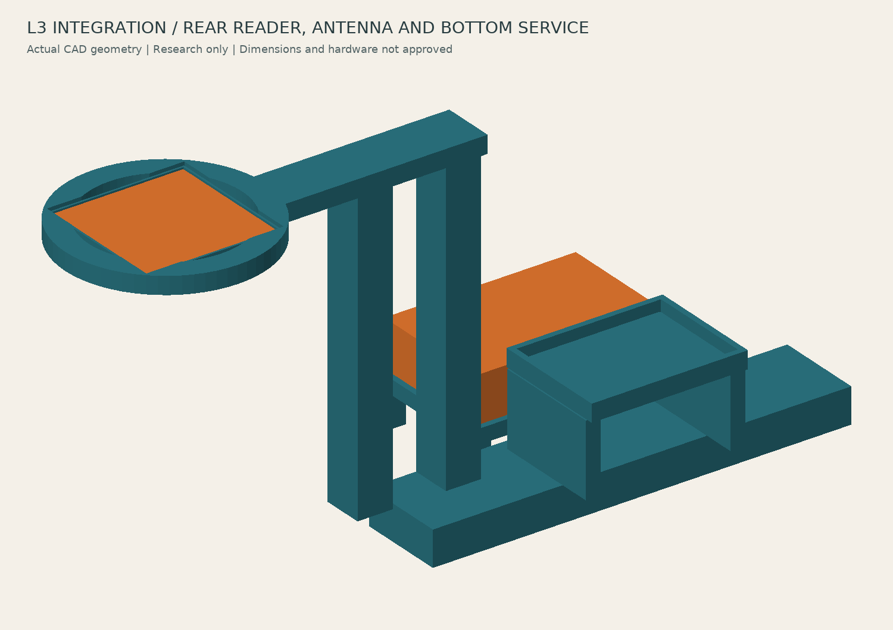
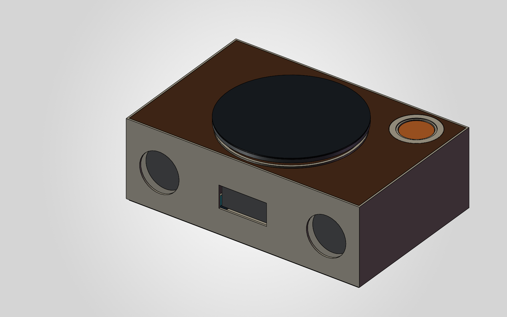

# 整机空间研究 v0.2 · L3融合

Record Companion — L3 整机空间研究 v0.2
日期：2026-10-14（北京时间）
来源主线：plan/product-next-stage 的 `003308b`（v0.1）。按[D092](../../../product/decisions.md)继续深化这套L3几何，本次v0.2在相同整机研究尺寸内接入PN7160 B版板外形，并采用V3的独立底部/后部维护思路。原V3工程保留。此为研究模型发布，实物模块的验证门槛不变；本轮范围见[V024](../../../product/validation.md#v0242026-10-14-l3整合与本机sw装配)。

本次实际融合
- 分离天线由旧50×40×1 mm占位改为B版44×44×1.6 mm制板输入，增加46×46 mm非金属可拆托盘并修改桥架让位。未假设PCB安装孔、真实线圈净空或接头；B版首轮为焊线。
- 新增45×32×1.6 mm核心板、独立后抽托架和两个支撑；器件高度、焊线、绝缘、紧固仍待回填。
- 复用V3的底部电池维护思路，加入带支脚的独立托架；现有65×42×18 mm电池占位向前移7 mm，让托架离开后横梁。该占位不是电池选型、膨胀余量或续航结论。
- 壳体400×260×134 mm、大盘220 mm、轴8 mm及两侧音箱研究输入保持本轮来源口径；没有缩小音腔或放大整机解决碰撞。

用途
这是一版实际 CadQuery/OCC 实体装配，用于审查空间、初步承重关系和局部拆卸路径。
不是生图，不是制造图，不是已经选定的成品。尚未达到实物装配或加工放行条件。
此前 P-L01 的 130×130 试板不在本模型内；本模型是新的整机研究。

打开
viewer.html：浏览器离线打开，支持拖动旋转、缩放、整机/内部/骨架/爆炸视图，需 WebGL。
record_companion_l3_study.step：正常装配 STEP，可导入 SolidWorks、FreeCAD 等。
record_companion_l3_exploded.step：人为移动零件的观察视图，不代表真实拆卸顺序。
parts/：运行 build_model.py 后生成 53 个部件的单独 STEP。
assembled.png、internal.png、exploded.png：由同一 CAD 三角网格做深度缓冲渲染的视图。
仓库保留源码、总装 STEP、视图与检查记录；单件 STEP 与 meshes.json 可由源码重建。
STEP 不含 SolidWorks 原生特征树；可修改源为 build_model.py 和 parameters.json。`part_manifest.json`登记各件性质、包络和体积。`import_solidworks.py`通过项目级Skill把这些真实实体保存为本机SLDPRT，并建立整机/内部两套SLDASM；采用固定组件作静态研究，不声称参数特征树、运动配合或制造图。

暂定尺寸（全部为本次研究输入，不是用户已确认值）
外壳 400×260×134 mm；加大盘的模型最高点为 152 mm。
大盘直径 220 mm，中心相对机身中心向前 15 mm。
本版低环外径 76 mm、内径 58 mm；不是旧 P-L01 的 84 mm 试样环。
左右各一只 100×130×100 mm 箱体，壁厚 3 mm。
每箱几何内空 1.095664 L，扣除简化扬声器占位在腔内的体积后约 1.026970 L。
上述尚未扣除未来真实撑条、密封及接线排量，不代表最终声学净容积或调音通过。

实际建模结果
v0.1原有47个部件；本次53个部件各为单个连通有效实体，最终装配未发现大于0.001 mm³的正体积相交。STEP回读及本机SW检查另见`integration_report.json`和`solidworks_summary.json`，以报告实际结果为准。
低环与大盘名义平面边距约 25.925 mm；不是手指、挂扣、生日异形卡或动态跳动的通过证据。
盘下固定扩散件顶面与承载盘底面名义间隙 7 mm；不代表转动实测。
geometry_report.json 为实际计算结果。

本机SW结果：53个SLDPRT均保存重开并核对单实体、体积和包络；整机53组件、内部46组件两套SLDASM均保存重开，固定状态、位姿及文件引用通过，SW静态干涉为0。53项递归依赖均存在于本机交付目录。SW导出STEP回读53个有效实体、包络400×260×152 mm；STL按53个零件分别输出，已逐文件读回二进制三角面，总计13,048面。STL为无单位格式，导出坐标有整体平移，不能直接和研究坐标原点混用。完整API日志与原生工程留本机，脱敏结果见`solidworks_summary.json`。

v0.1既有纠偏与v0.2新增维护检查
以下四项是v0.1已有修复，本次保留并复核：
初版电机托板与四根支柱穿插：支柱改至两侧导轨上方，承力板随之加宽。
托芯与支撑环穿插：重新分开台阶及内径。
支架孔曾将末端分为不连通实体：改为连续环形承托。
电机下方横梁妨碍底部拆卸：改成上方悬挂托板，使用两颗底面可达的螺钉占位。
移除底盖及两颗托板螺钉后，检查电机/托板/输出轴下移 2、10、30、60、100 mm 的位置。
本次另检查读卡器后抽、电池/托架/底盖向下、天线/托盘向上三条路线，各为2、10、30、60、100 mm共5个离散位置。天线须先拆低环、托芯、支撑环与卡；读卡器须先拆后盖。详见removal_report.json。这是离散位置检查，不是完整连续扫掠证明；不含线束、紧固解锁和工具。

仍需结构深化，不能据此声称已能制造
1. 轴承座、电机、屏幕、电池、主控和扬声器均有不同程度的简化占位，不是厂商准确模型。
2. 轴承轴向定位、盘毂连接与防脱、联轴器锁紧及电机固定螺钉未完成。
3. 导轨与底座、桥架、箱体、外壳、底盖、屏幕和电池的完整紧固尚未设计；部分目前只有接触关系。
4. 扬声器与外壳开口之间有退距，需补前障板连接/密封或调整安装位置；没有声学验证。
5. S1 平放浅座是本版建模姿态，S2 浅槽没有被排除；未建生日轮廓、挂扣、抓取缺口和真实天线接头。
6. 右后支架有悬臂，需检查挠度、固定和振动传播；零穿插不等于强度或低噪通过。
7. 网罩、装饰倒角、实体按键、电源与数据接口、线束、LED 槽细节和散热尚未完整建模。
8. 模型尚未实物制造，音质、NFC、电气、热、噪声与耐久测试均未进行。

复现
v0.1生成环境为Python 3.12/CadQuery 2.7.0；v0.2已在Python 3.10/CadQuery 2.7.0重建。原生SW由Python 3.13/pywin32连接SOLIDWORKS 2026执行。
主要依赖：cadquery、matplotlib、numpy、Pillow（查看器本身无外部依赖）。
python build_model.py
python check_removal.py
python render_raster.py
python make_viewer.py
python verify_integration.py

本机原生工程复现（先运行项目级Skill的`sw_preflight.py`，再提供本机输出位置）：
`python import_solidworks.py --skill-dir <project-skill-directory> --output-dir <local-output-directory>`
完整原生工程及API日志留本机，公开目录只保留研究源、STEP、图和脱敏摘要。导入实体仍可在SW中增加新特征，但原始几何尺寸应修改CadQuery源再重建，不能把导入件称作已完全参数化的SW设计。
build_model.py 会先生成常规预览；render_raster.py 再用逐像素深度缓冲生成交付质量视图。
parameters.json 只控制源码中实际读取的部分研究尺寸，status 与 units 是说明元数据；它不是全约束的整机参数化模型。删除了此前没有被源码读取的 disc_top 与 shaft_diameter 两项，已有几何未改变。当前盘顶 152 mm、轴径 8 mm，以及顶板、盘体和部分支撑的高度仍由 build_model.py 中的固定值定义；修改 case_height 等单项不会自动联动这些零件。需要改形时须一并审阅源码尺寸和结构关系，再重新运行全部几何检查，不能只改 JSON 后直接下单。
所有文本读写使用 UTF-8，避免 Windows 默认编码影响中文查看器生成。
查看器已在独立Edge浏览器检查四模式×四角度共16种组合，部件计数为53/46/37/53，WebGL与页面错误为0；默认缩放的全部顶点均在画布内。拖动、0.6–1.8缩放、滚轮、恢复、切模式保留视角及1400×1100/800×600适配已检查。爆炸图采用当前可见几何中心和包围球适配，原底板边缘裁切已修正；这一浏览器验证不增加物理装配结论。

下一步建议
先用这版确定承力与维护关系，优先深化盘轴防脱、挂件座可拆固定与前障板接口。
收到准确器件型号后替换占位，重新做装配、拆卸和公差检查，再生成加工零件图。
