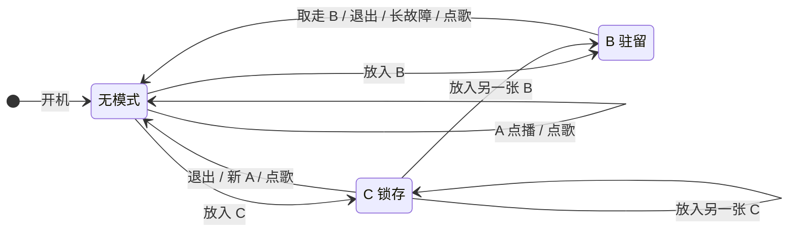
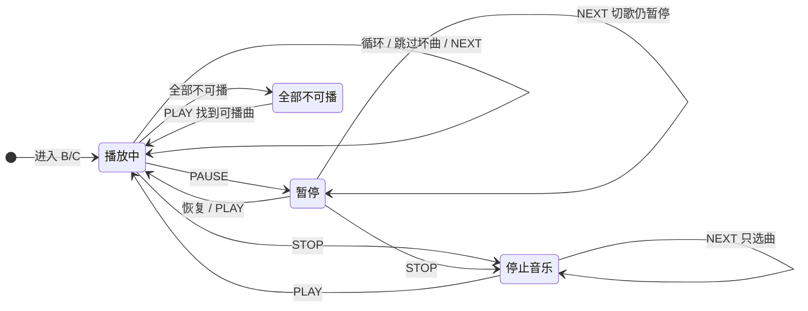

# ABC 模式状态图

本页把 D052、D066–D085、D089–D095 中已确认的 ABC 行为画成两张状态图，方便快速查阅。图只是规则的另一种呈现，**不新增或修改任何决定**。文字规则以[决策记录](decisions.md)和[共享接口 RC-05A](interfaces.md#rc-05a--abc行为状态机与冲突消解草案2026-10-09)为准，两者不一致时以文字为准并修正本图。读卡器如何判断“确认放入/确认取走”见[唱片识别专项的在位状态图](../features/records/README.md)，本页从“已确认的放入/取走事件”开始。

## 模式层：谁拥有当前播放

A 是一次性点播，不形成常驻模式；只有 B 和 C 建立持续会话。感应座只有一个，所以“放入另一张 B/C”只会发生在原来的 C 已离座之后。

| 转换 | 规则 | 依据 |
|---|---|---|
| 开机 | 已在位的唱片只识别，等待用户明确启动；旧 C 不恢复。普通播放记住所选歌曲或歌单，但保持静音，明确按播放后从开头播放 | D052、D073、D093 |
| 无模式 → 无模式 | 放入有效 A，或本体/网页点歌，普通播放一首 | D066、D068 |
| 无模式 → B | 放入有效 B，从模式起点运行并循环 | D066、D067 |
| 无模式 → C | 放入有效 C，运行并循环 | D066、D067 |
| B → 无模式 | 确认取走这张 B（停止并清空，即使音频已暂停或停止） | D066、D075 |
| | `MODE_EXIT` 手动退出 | D067、D075 |
| | 读卡故障超过保护阈值（记为故障，不记为取走） | D072 |
| | 有效新 A，或本体/网页点歌，预检通过 | D068 |
| C → C | 取走 C，模式继续 | D066 |
| | 同一张 C 放回且原会话仍运行：不重启、不改进度、不解除停止 | D071 |
| C → B / C → 新 C | C 已离座时放入另一张有效 B/C：完整替换旧模式，之后不自动恢复旧 C | D089 |
| C → 无模式 | `MODE_EXIT`；有效新 A；本体/网页点歌，预检通过 | D067、D068 |

几条图上不好表达的约束：

- **预检失败不改变旧模式（D074）。** 新 A、新 B/C、点歌或明确执行新绑定，目标无效时只报错，旧模式保持。预检通过后旧模式先退出，若新目标实际启动失败，就报错并停止，不回滚旧模式，也不因同片仍在位自动重试。
- **手动退出后同片仍在位不会自动重启（D067）。** 必须真实取走再放入。读卡故障保护退出后同理，恢复后看到同一张卡也不算新放入（D072）。
- **不算新放入的情况（D046、D078、D094）。** 持续在位、重复读卡、在位修改绑定，以及在绑定页放片登记身份，都不会触发播放。新绑定在 B 真实取放、C 退出后重新启动，或用户明确执行新绑定时才生效。

## 音频层：B/C 会话内部

在 B/C 会话内，音频状态独立变化，**除上面的退出条件外，都不会结束模式**。

| 转换 | 规则 | 依据 |
|---|---|---|
| 播放中 → 播放中 | 歌曲结束循环到下一首；坏曲记录并跳过，本会话不重试；`MODE_NEXT` 播放下一首 | D067、D080 |
| 播放中 → 暂停 | 保留当前播放位置 | D068、D079 |
| 暂停 → 暂停 | 按下一首：切到下一首，继续暂停 | D095 |
| 暂停 → 播放中 | 没切过歌：从暂停位置继续。切过歌后明确按播放：从新选曲开头播放 | D079、D095 |
| → 停止音乐 | `STOP_AUDIO` 只停音频、禁止自动循环，模式保持 | D075 |
| 停止音乐 → 停止音乐 | `MODE_NEXT` 只换选中曲，保持静音 | D082 |
| 停止音乐 → 播放中 | `MODE_PLAY` 从选中曲开头播放，不回到歌单第一首 | D079、D082 |
| 播放中 → 全部不可播 | 歌单内没有可播曲目，报错停止，模式保持 | D080 |
| 全部不可播 → 播放中 | 明确按播放：从当前选曲开始，按活动歌单快照的原顺序查找，跳过仍坏的曲目，找到后从开头播放。修复文件本身不会自动发声 | D084、D090 |
| 全部不可播时按 NEXT | **未决定**，图中未画 | D095 未覆盖 |

补充说明：

- **迟到的歌曲结束回调不会重新发声（D075、D082）。** 停止音乐或暂停后才到达的旧回调一律忽略。同一张 C 取走再放回，也不会解除停止（D071）。
- **会话使用进入时的歌单快照（D077）。** 运行中保存新的歌单只在下次进入模式时生效。
- **坏曲修复完整校验并发布后，解除本会话的跳过标记（D084）。** 不会插播，要等下次正常轮到；再次失败会重新标记。
